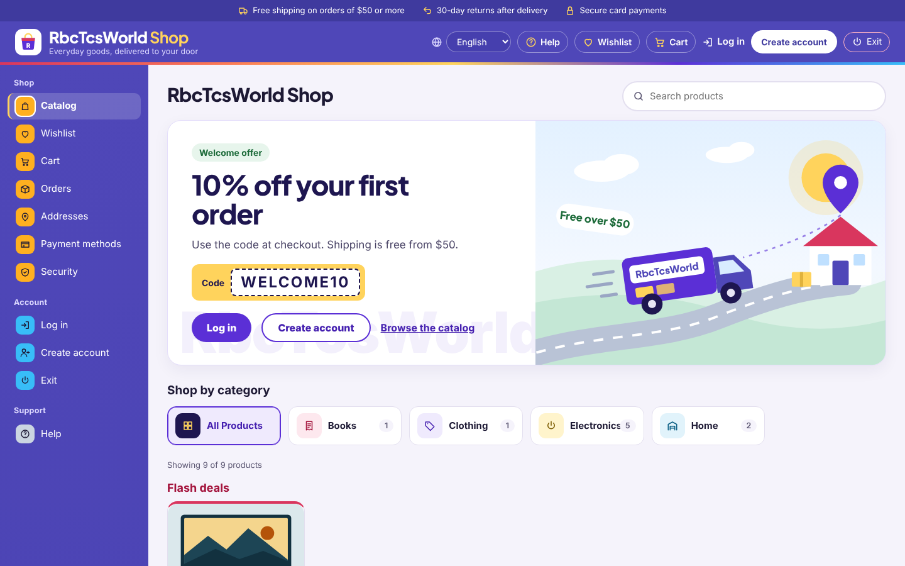
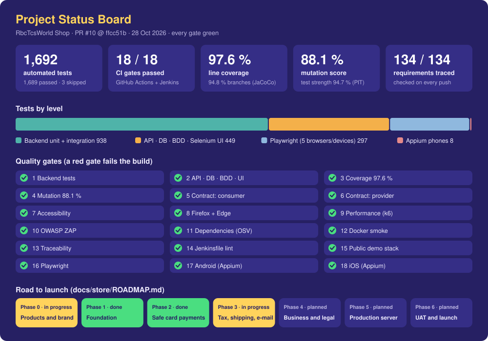
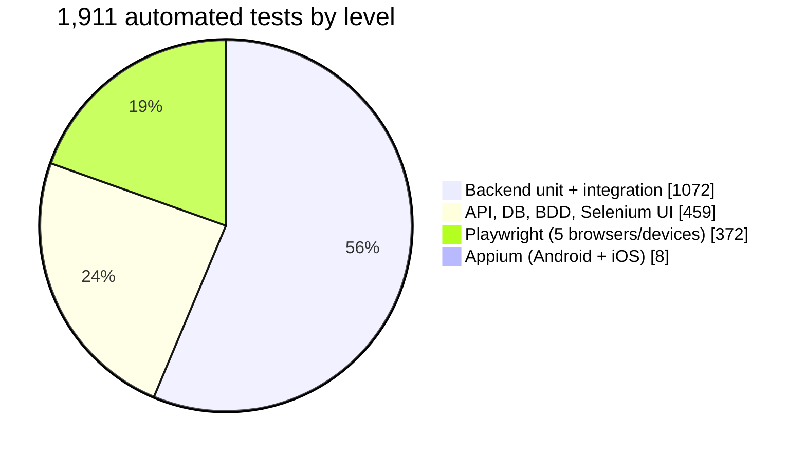
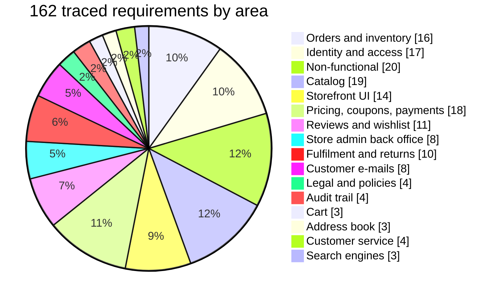
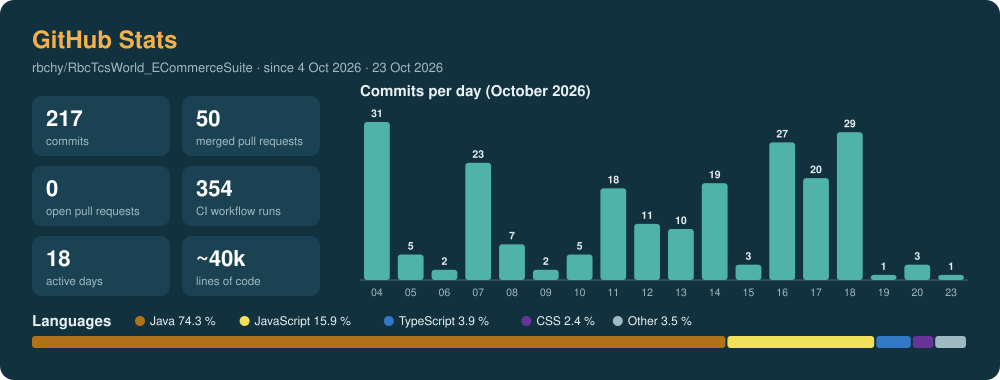

# RbcTcsWorld Shop

[](https://github.com/rbchy/RbcTcsWorld/actions/workflows/ci.yml)


[](https://rbchy.github.io/RbcTcsWorld/coverage/)
[](https://rbchy.github.io/RbcTcsWorld/mutation/)
[](https://rbchy.github.io/RbcTcsWorld/)

**RbcTcsWorld Shop is an online store on its way to selling for real.** Everyday goods, delivered to your door:
catalog, cart, checkout with a delivery address, guest checkout and an address book, size and colour variants, a
faceted filter panel with "Shop by category" tiles, flash deals with a countdown, "customers also bought", reviews,
wishlist, returns, order e-mails, invoice PDFs, two-factor sign-in, a saved-card wallet, a store back office with
coupons, multi-warehouse stock, reports and an append-only audit trail, in six languages.

The code was built test-first in the [E-Commerce Suite](https://github.com/rbchy/RbcTcsWorld_ECommerceSuite) and keeps
its full history and its quality bar: every change goes through 19 CI gates. This repository takes it through the
steps a live store needs: safe card payments, real tax, real shipping, e-mail from its own domain, backups, legal pages
and a business behind it. **Nothing here takes real orders yet**; until launch the store runs in demo mode with test
cards only.

Owner: **RB Chowdhury**, QA Automation Engineer / SDET - [GitHub](https://github.com/rbchy) · [LinkedIn](https://www.linkedin.com/in/rbchy/) · [Website](https://rbchy.github.io/rbchy/)



---

## 🚦 Project Status Board



[](https://github.com/rbchy/RbcTcsWorld/actions/workflows/ci.yml)


The board shows the GitHub Actions run of `main` on 26 Oct 2026 (commit `ddcd72c`). The CI badge above is live;
the board is redrawn after a release with [`docs/images/make_readme_cards.py`](docs/images/make_readme_cards.py).

## 🥧 Breakdown





Every requirement links to its tests in the [traceability matrix](docs/qa/TRACEABILITY_MATRIX.md); CI fails if one has none.

## 📈 GitHub Stats




The badges update live from GitHub; the card above is a snapshot of the same day as the status board.

---

## Where it stands

| | |
|---|---|
| Independent since | 25 Oct 2026 (`c5c5091`); the full git history of the code is kept |
| Done in this repository | Phase 1: own project names and links, roadmap, [ADR-0010](docs/adr/0010-from-portfolio-to-live-store.md); a store look (indigo frame, bag logo, Plus Jakarta Sans), the welcome banner with the delivery picture, "Shop by category" tiles |
| Quality bar | 1,911 automated tests, 19 CI quality gates, 97.2 % line coverage, 87.6 % mutation score, 162 traced requirements |
| Phase 2 (done) | Stripe Elements and signed webhooks: card numbers never reach our server, an order is paid only on Stripe's word, exactly once ([ADR-0011](docs/adr/0011-stripe-elements-and-webhooks.md)) |
| Phase 3 (done) | Stripe Tax: the right sales tax for every delivery address, recorded with Stripe after payment ([ADR-0012](docs/adr/0012-stripe-tax.md)); Shippo labels with real tracking numbers, delivered when the carrier says so ([ADR-0013](docs/adr/0013-shippo-labels-and-tracking.md)); order e-mail from the store's own domain through Amazon SES, bounced addresses never e-mailed again ([ADR-0014](docs/adr/0014-amazon-ses-mail.md)) |
| Product photos (done) | The owner uploads a photo from the admin form (phone or computer); the backend turns it upright, scales it to 1600 px and saves a new file without EXIF or GPS data, in the database so the backups cover it ([ADR-0017](docs/adr/0017-product-photo-uploads.md)) |
| Customer service (done) | A contact form on every page (ticket number, promised answer time, spam-proof without a CAPTCHA) and Admin -> Messages to answer by e-mail ([ADR-0018](docs/adr/0018-contact-form.md)) |
| Search engines (done) | Every product at a real address (`/products/12/travel-mug`) with title, description, price and stock data for Google; robots.txt and a sitemap; private pages and the demo never indexed ([ADR-0019](docs/adr/0019-search-engines.md)) |
| Partner products (done) | Amazon and other affiliate links next to the shop's own products: "Buy at Amazon" instead of price and cart, the required disclosure, never in our cart or orders ([ADR-0020](docs/adr/0020-affiliate-products.md)) |
| Not decided yet | what the store sells, where the products come from (phase 0, owner) |

## Roadmap to launch

The details, owners and running costs are in [docs/store/ROADMAP.md](docs/store/ROADMAP.md).

| Phase | What | Who | Status |
|---|---|---|---|
| 0 | Decide the products, suppliers and brand | Owner | in progress |
| 1 | This repository: history, links, project names, README, roadmap, decision record, store look | Engineering | **done** |
| 2 | Card payments through Stripe Elements and webhooks (card numbers never reach our server) | Engineering | **done** |
| 3 | Real sales tax, shipping rates and labels, e-mail from the store's domain | Engineering | **done** (accounts and domain: owner) |
| 4 | Business registration, sales tax license, privacy policy, terms, return policy | Owner + professionals | in progress (policy pages built; LLC, EIN, license: owner) |
| 5 | Production server: demo mode off, daily backups, monitoring, restore drill | Engineering | **built** (server, domain, bucket: owner) |
| 6 | User acceptance test with real cards and refunds, then launch | Owner + Engineering | planned |

Every phase keeps the inherited rule: a change reaches `main` only through a pull request with all CI gates green, and
new behaviour arrives with its tests and a traced requirement.

---

## Reviewing this in 5 minutes

1. **Where the store is going:** [Roadmap](docs/store/ROADMAP.md) and the decision to build it on this code,
   [ADR-0010](docs/adr/0010-from-portfolio-to-live-store.md).
2. **Latest build:** the [GitHub Actions runs](https://github.com/rbchy/RbcTcsWorld/actions) (19 gates per push).
3. **Live reports:** [all reports](https://rbchy.github.io/RbcTcsWorld/reports/) · [Allure](https://rbchy.github.io/RbcTcsWorld/) ·
   [Cucumber](https://rbchy.github.io/RbcTcsWorld/cucumber/) · [JaCoCo coverage](https://rbchy.github.io/RbcTcsWorld/coverage/) ·
   [PIT mutation](https://rbchy.github.io/RbcTcsWorld/mutation/) · [Playwright](https://rbchy.github.io/RbcTcsWorld/playwright/)
4. **Defects the tests actually found:** [Defect Reports](docs/qa/DEFECT_REPORTS.md) - 30 entries, each with
   evidence, root cause, fix and regression test.
5. **How release decisions are made:** [Test Strategy](docs/qa/TEST_STRATEGY.md) · [Risk Register](docs/qa/RISK_REGISTER.md) ·
   [Test Summary Report (GO / NO-GO)](docs/qa/TEST_SUMMARY_REPORT.md) · [UAT Plan](docs/qa/UAT_PLAN.md)
   (10 tasks for real users, phase 6 runs it with small real orders)
6. **Why it is built this way:** [Architecture Decision Records](docs/adr/) - 25 short records, each with the
   alternatives and the price paid. Commands: `make help` · [Contributing](CONTRIBUTING.md) · [MIT License](LICENSE)

---

## Quality gates

A gate fails the build. Nothing is "reported only" unless the table says so.

| # | Gate | Threshold | Current | Tool |
|---|---|---|---|---|
| 1 | Backend unit + integration | 100 % pass | 1,004 / 1,004 | JUnit 5, Mockito, H2 + Flyway |
| 2 | API, database, BDD, UI | 100 % pass | 451 / 451 | REST Assured, JDBC, Cucumber 7, Selenium 4, Mailpit |
| 3 | Line / branch coverage | >= 97 % / >= 88 % | 97.2 % / 93.1 % | JaCoCo |
| 4 | Mutation score | >= 84 % | 87.6 % (test strength 93.7 %) | PIT |
| 5 | API contract, consumer side | every response matches its schema | 12 strict JSON Schemas | json-schema-validator |
| 6 | API contract, provider side | no breaking change vs. approved baseline | 0 (gate has its own self-test) | openapi-diff |
| 7 | Accessibility | 0 serious / critical | 0 on 23 pages | axe-core, WCAG 2.1 A + AA |
| 8 | Cross-browser | 100 % pass | 59 / 59 in Firefox and Edge | Selenium, CI matrix |
| 9 | Performance | SLO thresholds (p95, error rate, no overselling) | within SLO | k6, JMeter (manual workflow) |
| 10 | DAST | 0 Medium / High | 0 | OWASP ZAP API scan |
| 11 | Dependencies | 0 known vulnerabilities, 0 open exceptions | 0 (complete SBOMs, self-test passed) | OSV-Scanner on CycloneDX SBOMs |
| 12 | Containers | stack healthy, smoke tests pass | 63 / 63 | Docker Compose |
| 13 | Traceability | every requirement has a test | 162 / 162 | `docs/qa/check_rtm.py` |
| 14 | Pipeline definition | Jenkinsfile valid | validated by a real Jenkins | declarative linter |
| 15 | Public demo stack | HTTPS, only 80/443 open, demo safeguards, nightly reset | all smoke checks pass | Docker Compose, Caddy, `deploy/smoke.sh` |
| 16 | Playwright (TypeScript) | 100 % pass, visual baselines match | 326 / 326 + 3 skipped by design (Chromium, Firefox, WebKit, Pixel 7, iPhone 14) | Playwright, axe-core |
| 17 | Phone: Android | 100 % pass (one rerun, reported as flaky) | 4 / 4 in Chrome on Android 14 | Appium 3 + UiAutomator2, Android emulator |
| 18 | Phone: iOS | 100 % pass (one rerun, reported as flaky) | 4 / 4 in Safari on the newest iPhone simulator | Appium 3 + XCUITest, macOS runner |
| 19 | Production stack | live settings, only 80/443 open, encrypted off-site backup, restore drill, restore, health alerts | all steps pass | Docker Compose, moto (S3 API), shell + cron |

Thresholds are set just under the measured value on purpose: they stop regressions without inviting
tests that exist only to move a number. How the test layers fit together and what each one found is described in
[docs/FOUNDATION.md](docs/FOUNDATION.md).

---

## Before the first real order

These are the gaps between the demo and a live store, in the order the roadmap closes them. Stating them is part of
the plan, not a footnote.

- **The live services are built but not switched on.** Stripe Elements (phase 2), Stripe Tax, Shippo and Amazon SES
  (phase 3) work in test mode; each needs the owner's account, keys and, for e-mail, the store's own domain. Until
  then the store runs on test cards, a flat 6 % tax, made-up tracking numbers and Mailpit.
- **Only the demo server is online.** The production stack (backups, restore drill, alerts) is built and proven in CI; it needs its own server and domain (phase 5).
- **No business yet:** the policy pages exist as drafts with placeholders; LLC, EIN, sales tax license and a lawyer's review come next (phase 4).
- **Products are samples** with drawn pictures until the owner decides what to sell (phase 0); photo upload is ready for the real ones.

---

## Stack

| Layer | Technology |
|---|---|
| Backend | Java 21, Spring Boot 4.1 (Spring 7, Jackson 3, Tomcat 11), Spring Security + JWT, PostgreSQL 16, Flyway |
| Storefront | React + Vite, six languages, installable as a desktop app (PWA) |
| Test automation | JUnit 5, REST Assured, Selenium 4 (Page Objects), Cucumber 7, Playwright (TypeScript), Appium 3, axe-core, JDBC |
| Test quality | JaCoCo, PIT |
| Non-functional | k6, OWASP ZAP, OSV-Scanner, openapi-diff |
| Reporting | Allure (trend history), Cucumber HTML, Playwright HTML, per-build QA dashboard |
| Delivery | Docker (multi-stage, non-root), Docker Compose, GitHub Actions, Jenkins |

---

## Run it

**Whole store, one command** (PostgreSQL + Redis + Mailpit + backend + storefront):

```bash
make doctor     # checks the machine first
make app        # storefront http://localhost:5173, API http://localhost:8081
make test       # the automated suites
make help       # everything else
```

Or double-click the launcher in `desktop/` (Mac `.command`, Windows `.bat`, Linux `.sh`).

**Development** (backend from Eclipse or Maven, live-reloading storefront):

```bash
docker compose up -d                              # PostgreSQL, Redis, Mailpit
cd backend && mvn spring-boot:run                 # API on 8081; Flyway creates tables and demo data
cd frontend && npm install && npm run dev         # storefront on 5173
```

| | |
|---|---|
| Backend API | http://localhost:8081 · OpenAPI description at `/v3/api-docs` |
| E-mails | Mailpit, http://localhost:8025 |
| Admin (dev only) | `admin@rbctcsworld.com` / `Admin@12345`, override with `ADMIN_EMAIL`, `ADMIN_PASSWORD` |
| Coupons | `WELCOME10`, `SAVE5`, `EXPIRED20`, `FUTURE15`, `DISABLED` |
| Test cards | `4242 4242 4242 4242` approved · `4000 0000 0000 0002` declined · any future expiry, any CVV |

**Eclipse:** File -> Import -> Maven -> Existing Maven Projects -> select this folder. The projects are
`rbctcsworld-shop`, `rbctcsworld-shop-backend` and `rbctcsworld-shop-automation`. After a pull: right-click the
project -> Maven -> Update Project.

## Run the tests

The backend tests need nothing running. **Every other suite tests a running shop: start it first** (Docker Desktop
running), otherwise each test fails with "Connection refused"; both suites then stop with one plain message instead.

```bash
git pull                                                               # the newest code and tests
mvn -f backend/pom.xml verify                                          # unit + integration + coverage gate (no shop needed)

make app                                                               # start the shop: 5173 + 8081 (once per session)
mvn -f automation/pom.xml clean test -DexcludedGroups=ui,mobile        # API, contract, DB, BDD, security
mvn -f automation/pom.xml clean test -Dgroups=ui -Dbrowser=edge        # UI: chrome | firefox | edge | safari
make playwright                                                        # Playwright: installs its browsers, 5 browsers and devices
make down                                                              # stop the shop (the data is kept)
```

---

## Documentation

**Store:** [Roadmap](docs/store/ROADMAP.md) · [ADR-0010: from portfolio to live store](docs/adr/0010-from-portfolio-to-live-store.md) ·
[ADR-0011: Stripe Elements and webhooks](docs/adr/0011-stripe-elements-and-webhooks.md) · [Stripe test-mode guide (Bangla)](docs/modules/STRIPE_ELEMENTS_BN.md) ·
[ADR-0012: Stripe Tax](docs/adr/0012-stripe-tax.md) · [Stripe Tax guide (Bangla)](docs/modules/STRIPE_TAX_BN.md) ·
[ADR-0013: Shippo](docs/adr/0013-shippo-labels-and-tracking.md) · [Shippo guide (Bangla)](docs/modules/SHIPPO_SHIPPING_BN.md) ·
[ADR-0014: Amazon SES](docs/adr/0014-amazon-ses-mail.md) · [SES guide (Bangla)](docs/modules/AMAZON_SES_MAIL_BN.md) ·
[ADR-0015: policies](docs/adr/0015-policies-from-the-shops-settings.md) ·
[ADR-0016: production stack](docs/adr/0016-production-stack-backups-and-alerts.md) · [Production server guide (Bangla)](docs/deploy/PRODUCTION_BN.md) ·
[ADR-0017: product photos](docs/adr/0017-product-photo-uploads.md) · [Product photo guide (Bangla)](docs/modules/PRODUCT_PHOTOS_BN.md) ·
[ADR-0018: contact form](docs/adr/0018-contact-form.md) · [Contact form guide (Bangla)](docs/modules/CONTACT_FORM_BN.md) ·
[ADR-0019: search engines](docs/adr/0019-search-engines.md) · [Search engine guide (Bangla)](docs/modules/SEARCH_ENGINES_BN.md) ·
[ADR-0020: partner products](docs/adr/0020-affiliate-products.md) · [Amazon affiliate guide (Bangla)](docs/modules/AFFILIATE_PRODUCTS_BN.md) ·
[ADR-0021: product descriptions](docs/adr/0021-product-descriptions.md) · [ADR-0022: account deletion](docs/adr/0022-self-service-account-deletion.md) · [ADR-0023: return labels](docs/adr/0023-prepaid-return-labels.md) · [ADR-0024: policy version per order](docs/adr/0024-policy-version-per-order.md) · [ADR-0025: HTML e-mail](docs/adr/0025-html-email-twin.md) · [Phase 4: business and legal (Bangla)](docs/modules/PHASE4_BUSINESS_LEGAL_BN.md) ·
[The inherited foundation](docs/FOUNDATION.md)

**QA documents (English):** [Strategy](docs/qa/TEST_STRATEGY.md) · [Plan](docs/qa/TEST_PLAN.md) ·
[Risks](docs/qa/RISK_REGISTER.md) · [Traceability (162 requirements)](docs/qa/TRACEABILITY_MATRIX.md) ·
[Defects (29)](docs/qa/DEFECT_REPORTS.md) · [Test Summary Report](docs/qa/TEST_SUMMARY_REPORT.md) ·
[UAT Plan](docs/qa/UAT_PLAN.md) · [UAT Summary](docs/qa/UAT_SUMMARY.md)

**Guides (Bangla):** [HELP_BN](docs/HELP_BN.md) to start, and one guide per feature or test layer in
[docs/modules/](docs/modules/) (cart, orders, payments, returns, admin back office, audit trail, Playwright, Appium,
security, mutation testing, CI/CD and more).

## License

[MIT](LICENSE)

---

A store is ready when its customers can trust it, not when its code compiles. This one starts from tests that
already find the expensive defects, and adds what real customers need, one tested step at a time.
