# RbcTcsWorld E-Commerce: সম্পূর্ণ সাহায্য গাইড (বাংলা)

এই এক ফাইলে প্রজেক্ট চালানো, ব্যবহার, টেস্ট, রিপোর্ট আর সমস্যা সমাধানের সব কিছু আছে। Command গুলো হুবহু কপি করে চালানো যায়।

**সূচিপত্র**

1. [এক নজরে](#১-এক-নজরে)
2. [Architecture: পুরো সিস্টেম কীভাবে সাজানো](#২-architecture-পুরো-সিস্টেম-কীভাবে-সাজানো)
3. [চালানো: কোন ডিভাইসে কীভাবে](#৩-চালানো-কোন-ডিভাইসে-কীভাবে)
4. [অ্যাপ ব্যবহার: মেনু, লগইন, রেজিস্ট্রেশন, help](#৪-অ্যাপ-ব্যবহার-মেনু-লগইন-রেজিস্ট্রেশন-help)
5. [Store admin প্যানেল](#৫-store-admin-প্যানেল)
6. [টেস্ট চালানো](#৬-টেস্ট-চালানো)
7. [রিপোর্ট তৈরি আর দেখা](#৭-রিপোর্ট-তৈরি-আর-দেখা)
8. [CI/CD: GitHub Actions আর Jenkins](#৮-cicd-github-actions-আর-jenkins)
9. [Git: প্রতিদিনের command](#৯-git-প্রতিদিনের-command)
10. [সমস্যা সমাধান: যা আগে হয়েছে](#১০-সমস্যা-সমাধান-যা-আগে-হয়েছে)
11. [ভবিষ্যতে যে সমস্যা আসতে পারে](#১১-ভবিষ্যতে-যে-সমস্যা-আসতে-পারে)
12. [দ্রুত command তালিকা (cheat sheet)](#১২-দ্রুত-command-তালিকা-cheat-sheet)

---

## ১. এক নজরে

| জিনিস | ঠিকানা বা মান |
|---|---|
| দোকান (storefront) | http://localhost:5173 |
| Backend API | http://localhost:8081 (OpenAPI: `/v3/api-docs`) |
| PostgreSQL | localhost:5432, database / user / password সব `ecommerce` |
| Redis | localhost:6379 (login lockout-এর হিসাব) |
| Mailpit (ইমেইল inbox) | http://localhost:8025 (দোকানের পাঠানো সব ইমেইল; বাইরে কিছু যায় না) |
| Jenkins | http://localhost:8080 |
| অ্যাডমিন লগইন (শুধু development) | `admin@rbctcsworld.com` / `Admin@12345` |
| কুপন | `WELCOME10` (চালু), `SAVE5` (চালু), `EXPIRED20` (মেয়াদ শেষ), `FUTURE15` (এখনো শুরু হয়নি), `DISABLED` (বন্ধ) |
| টেস্ট কার্ড | `4242424242424242` পাস · `4000000000000002` declined · `4000000000009995` টাকা নেই |
| ব্যবসার নিয়ম | $50 থেকে ফ্রি শিপিং (নইলে $5.99), কর ৬%, ৫ বার ভুল পাসওয়ার্ডে ১৫ মিনিট লক, ৩০ দিনের মধ্যে রিটার্ন |
| Session | access token ১৫ মিনিট, refresh token ১৪ দিন (প্রতিবার ব্যবহারে বদলায়) |
| পেমেন্ট | default mock; `PAYMENT_PROVIDER=stripe` + `STRIPE_SECRET_KEY=sk_test_...` দিলে Stripe test mode |

> Port 8080 ইচ্ছা করেই Jenkins-এর জন্য খালি রাখা হয়েছে, তাই API চলে 8081-এ।

---

## ২. Architecture: পুরো সিস্টেম কীভাবে সাজানো

### ২.১ চলমান অ্যাপ

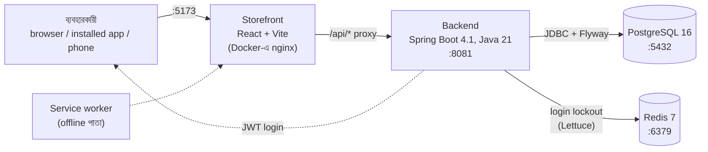

- Storefront কখনো সরাসরি database-এ যায় না। সব কাজ `/api` দিয়ে backend-এ যায়।
- Docker-এ nginx `/api`-কে backend-এ পাঠায়। Development-এ (`npm run dev`) একই কাজ করে Vite-এর proxy।
- লগইনের পর backend দুটো token দেয়: ১৫ মিনিটের access token (JWT) আর ১৪ দিনের refresh token। Browser দুটোই `localStorage`-এ রাখে। Access token-এর মেয়াদ শেষ হলে storefront নিজেই refresh করে নেয়, ব্যবহারকারী টেরও পান না।
- ভুল পাসওয়ার্ডের হিসাব থাকে Redis-এ, তাই একাধিক backend থাকলেও সবাই একই হিসাব দেখে। Redis বন্ধ হলেও login চলে।
- Database-এর টেবিল আর demo ডেটা Flyway তৈরি করে (`backend/src/main/resources/db/migration`, V1 থেকে V7)।

### ২.২ টেস্ট সিস্টেম

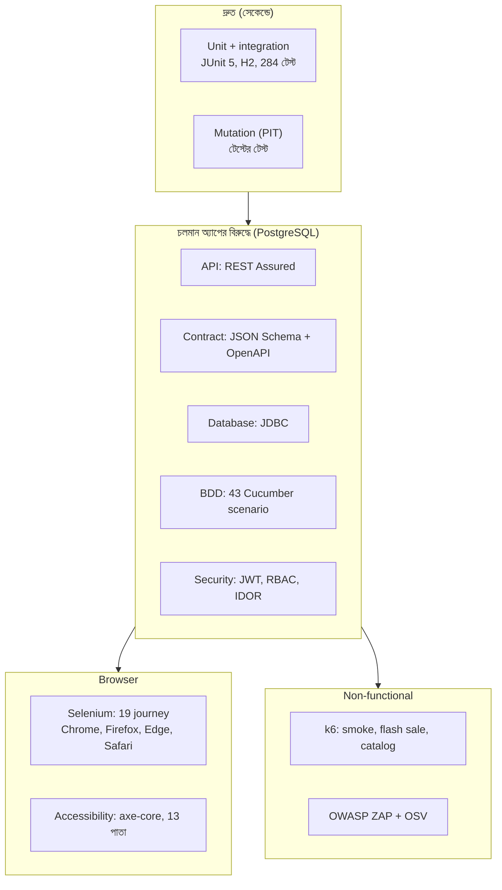

### ২.৩ ফোল্ডারের কাঠামো (frame)

```text
RbcTcsWorld_ECommerceSuite/
├── backend/          Spring Boot API, unit + integration টেস্ট, PIT profile
├── frontend/         React storefront, admin প্যানেল, ৬ ভাষা, PWA
│   ├── src/          main.jsx (route), Layout.jsx (topbar + sidebar), i18n.js, help.js, pages/
│   └── public/       manifest, sw.js, offline.html, icons
├── automation/       API client, Page Object, Cucumber feature, schema, test data
├── performance/      k6 script (tests/), রিপোর্ট (reports/)
├── security/         ZAP নিয়ম, SBOM + OSV scan
├── desktop/          Mac, Windows, Linux-এর এক ক্লিক launcher
├── ci/               Jenkins-এর QA Reports dashboard (qa_dashboard.py)
├── docs/qa/          Strategy, Plan, Risk, RTM, Defect, Summary report
├── docs/modules/     প্রতিটা অংশের বাংলা গাইড
├── docker-compose.yml
├── Jenkinsfile
└── .github/workflows/  GitHub Actions
```

---

## ৩. চালানো: কোন ডিভাইসে কীভাবে

কোন পথ বেছে নেবেন:

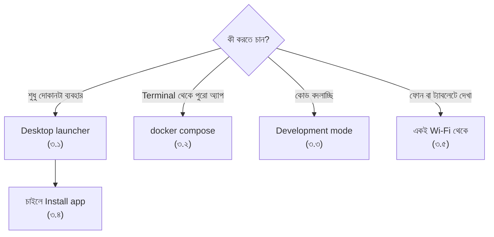

**আগে লাগবে:** Docker Desktop, Git। Development-এর জন্য আরও লাগবে JDK 21, Maven, Node.js 20+।

```bash
git clone https://github.com/rbchy/RbcTcsWorld_ECommerceSuite.git
cd RbcTcsWorld_ECommerceSuite
```

### ৩.১ Desktop launcher (সবচেয়ে সহজ)

| ডিভাইস | চালু করতে | বন্ধ করতে |
|---|---|---|
| Mac | `desktop/RbcTcsWorld-Mac.command`-এ ডাবল-ক্লিক | `RbcTcsWorld-Stop-Mac.command` |
| Windows | `desktop\RbcTcsWorld-Windows.bat`-এ ডাবল-ক্লিক | `RbcTcsWorld-Stop-Windows.bat` |
| Linux | `./desktop/rbctcsworld-linux.sh` | `docker compose --profile app down` |

- Launcher নিজেই Docker Desktop চালু করে (বন্ধ থাকলে), তারপর database, backend আর storefront চালিয়ে browser খুলে দেয়।
- প্রথমবার image তৈরিতে কয়েক মিনিট লাগে, পরের বার কয়েক সেকেন্ড।
- Mac প্রথমবার "unidentified developer" বললে: ফাইলে right-click → **Open** → **Open**।
- Linux-এ "Permission denied" এলে: `chmod +x desktop/*.sh desktop/*.command`

### ৩.২ এক command-এ পুরো অ্যাপ (Mac, Windows, Linux সব জায়গায় একই)

```bash
docker compose --profile app up -d --build --wait   # চালু, তৈরি না হওয়া পর্যন্ত অপেক্ষা
docker compose --profile app ps                     # কোনটা চলছে
docker compose --profile app logs -f backend        # backend-এর log দেখা (Ctrl+C দিয়ে বের হন)
docker compose --profile app down                   # বন্ধ, ডেটা থাকে
docker compose --profile app down -v                # বন্ধ + database মুছে নতুন করে শুরু
```

### ৩.৩ Development mode (Eclipse বা terminal)

```bash
docker compose up -d                       # শুধু PostgreSQL
cd backend && mvn spring-boot:run          # API :8081 (Eclipse-এ: EcommerceApplication → Run As → Java Application)
cd frontend && npm install && npm run dev  # UI :5173, কোড save করলেই পাতা বদলায়
```

- Production-এর মতো build দেখতে: `cd frontend && npm run build && npm run preview`
- Development mode-এ service worker বন্ধ থাকে, তাই পুরোনো পাতা cache থেকে আসে না।

### ৩.৪ Installable desktop app (PWA)

1. দোকান চালু করে Chrome বা Edge-এ http://localhost:5173 খুলুন।
2. Topbar-এ **Install app** চাপুন (অথবা address bar-এর install আইকন)।
3. দোকানটা নিজের window-এ খোলে, Dock বা Start menu-তে আইকনসহ।

- Server বন্ধ থাকলে app একটা "দোকান চালু নেই, launcher চালান" পাতা দেখায়।
- দাম, স্টক আর অর্ডার কখনো cache হয় না, সবসময় server থেকে আসে।
- Safari (Mac): File → **Add to Dock**।

### ৩.৫ ফোন বা ট্যাবলেট থেকে (একই Wi-Fi)

```bash
ipconfig getifaddr en0        # Mac-এর IP, যেমন 192.168.1.23 (Windows: ipconfig, Linux: hostname -I)
```

তারপর ফোনের browser-এ `http://192.168.1.23:5173` খুলুন।

- মোবাইলে মেনু "Menu" বোতামের পেছনে থাকে।
- IP দিয়ে খুললে **Install app** আসে না, কারণ install-এর জন্য HTTPS লাগে (শুধু `localhost`-এ ছাড় আছে)।
- না খুললে Mac-এর firewall Docker-কে আটকাচ্ছে কিনা দেখুন: System Settings → Network → Firewall।

### ৩.৬ ইন্টারনেটে live demo (Oracle Cloud ফ্রি সার্ভার)

Mac বন্ধ থাকলেও শপ একটা `https://` লিংকে চালু রাখতে পুরো গাইড আছে: [deploy/ORACLE_CLOUD_BN.md](deploy/ORACLE_CLOUD_BN.md)।

```bash
# সার্ভারে, একবার
curl -fsSL https://raw.githubusercontent.com/rbchy/RbcTcsWorld_ECommerceSuite/main/deploy/setup-vm.sh | bash
# চালু বা আপডেট (প্রতিবার merge-এর পর)
~/RbcTcsWorld_ECommerceSuite/deploy/deploy.sh
```

- Demo mode-এ উপরে হলুদ ফিতা থাকে, শুধু টেস্ট কার্ড চলে, আর প্রতি রাত ৩:৩০-এ সব reset হয়।
- Development-এর secret বা `Admin@12345` থাকলে backend চালুই হয় না।

---

## ৪. অ্যাপ ব্যবহার: মেনু, লগইন, রেজিস্ট্রেশন, help

### ৪.১ মেনুর মানচিত্র

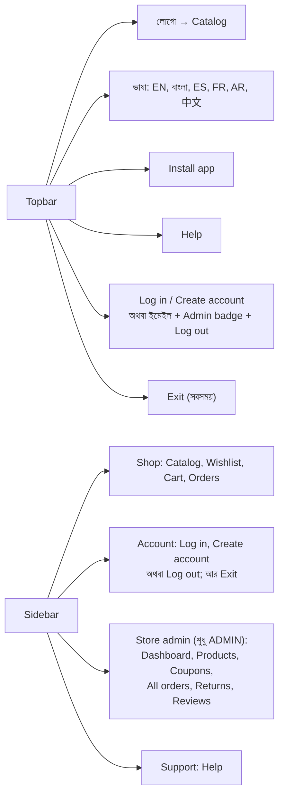

| মেনু | ঠিকানা | লগইন লাগবে? | কী করা যায় |
|---|---|---|---|
| Catalog | `#/` | না | পণ্য দেখা, নাম দিয়ে খোঁজা, পরিমাণ বেছে Add to cart, WELCOME10 ব্যানার |
| পণ্যের পাতা | `#/products/{id}` | না (রিভিউ লিখতে হ্যাঁ) | বিস্তারিত, রিভিউ, রেটিং-এর ভাগ |
| Wishlist | `#/wishlist` | হ্যাঁ | পছন্দের পণ্য রাখা, cart-এ পাঠানো |
| Cart | `#/cart` | হ্যাঁ | পরিমাণ বদলানো, মুছে ফেলা, Checkout-এ যাওয়া |
| Checkout | `#/checkout` | হ্যাঁ | কুপন, শিপিং + কর হিসাব, কার্ডে পেমেন্ট |
| Orders | `#/orders` | হ্যাঁ | নিজের অর্ডার তালিকা |
| অর্ডারের পাতা | `#/orders/{id}` | হ্যাঁ | অবস্থা, ট্র্যাকিং, বাতিল, রিটার্নের অনুরোধ |
| Log in / Create account | `#/login`, `#/register` | না | নিচে ৪.২ দেখুন |
| Help | `#/help`, `#/help/{topic}` | না | ৯টা বিষয়, ৬ ভাষায়, খোঁজা যায় |
| Exit-এর পরের পাতা | `#/goodbye` | না | "আপনি শপ থেকে বেরিয়ে এসেছেন", Close window, Back to the shop |

- লগইন লাগে এমন পাতায় লগইন ছাড়া গেলে আগে লগইন পাতা আসে। লগইনের পর সেই পাতাতেই ফিরে যায়।
- কীবোর্ড: Tab দিয়ে ঘোরা, পাতার শুরুতে "Skip to content", মোবাইল মেনু Esc দিয়ে বন্ধ হয়।

### ৪.২ রেজিস্ট্রেশন আর লগইন

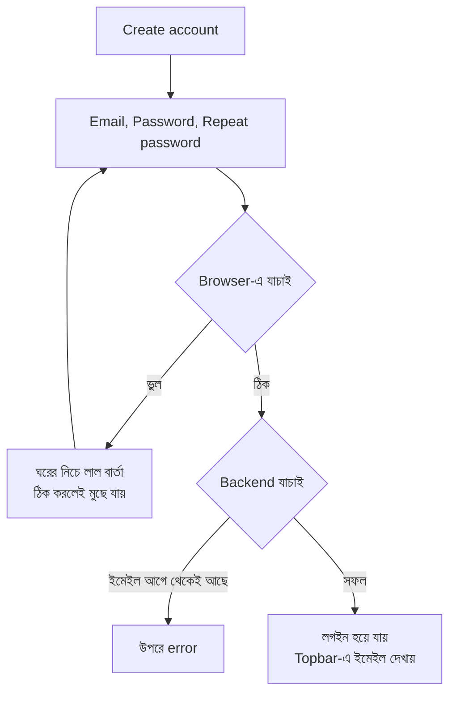

| ঘর | নিয়ম |
|---|---|
| Email | খালি রাখা যাবে না, সঠিক ফরম্যাট (`নাম@ডোমেইন.com`) |
| Password | ৮ থেকে ৭২ অক্ষর |
| Repeat password | Password-এর সাথে হুবহু মিলতে হবে (শুধু রেজিস্ট্রেশনে) |

- **Show password** টিক দিলে পাসওয়ার্ড দেখা যায়।
- পরপর ৫ বার ভুল পাসওয়ার্ড দিলে ঐ ইমেইল ১৫ মিনিট লক থাকে (HTTP 429)। লক Redis-এ থাকে, তাই backend restart দিলেও খোলে না। Development-এ তাড়াতাড়ি খুলতে: `docker compose exec redis redis-cli FLUSHALL`।
- লগইন থাকে ১৪ দিন পর্যন্ত (প্রতিবার ব্যবহারে নতুন করে শুরু হয়)। এর মধ্যে মাঝে মাঝে আবার লগইন করতে হয় না।
- Log out: Topbar-এর **Log out** বোতাম (দরজা-তীর আইকন), অথবা sidebar-এর Account অংশে **Log out**। এতে server-এও session বন্ধ হয়, অন্য কেউ token কপি করে রাখলেও আর কাজে লাগবে না। লগ আউটের পর Catalog-এ ফিরে আসে।
- Exit: Topbar-এর **Exit** বোতাম (পাওয়ার আইকন) বা sidebar-এর **Exit**। লগইন থাকলে আগে লগ আউট করে, তারপর `#/goodbye` পাতা দেখায় আর ব্রাউজারকে উইন্ডো বন্ধ করতে বলে।
  - ব্রাউজার শুধু script-এ খোলা উইন্ডো বন্ধ করতে দেয়। নিজে খোলা ট্যাব খোলাই থাকে; তখন goodbye পাতার কথামতো `⌘ W` (Mac) বা `Ctrl + W` চাপুন।
  - Exit **server বন্ধ করে না** (নিরাপত্তার জন্য ইচ্ছা করেই: ওয়েব পাতার একটা বোতাম যেন পুরো শপ বন্ধ করতে না পারে)। নিজের Mac-এ সব বন্ধ করতে ডেস্কটপের `RbcTcsWorld-Stop` লঞ্চার চালান।
  - মোবাইলে (সরু স্ক্রিন) Log out আর Exit শুধু আইকন হিসেবে দেখায়; screen reader তবু নাম পড়ে।

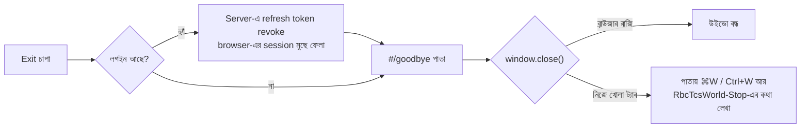
- "Session expired. Please log in again." দেখালে: refresh token-এর মেয়াদ শেষ, logout হয়েছে, অথবা একই token দুবার ব্যবহার হয়েছে (চুরির সন্দেহ)। আবার লগইন করুন।

### ৪.৩ কেনাকাটার পুরো পথ

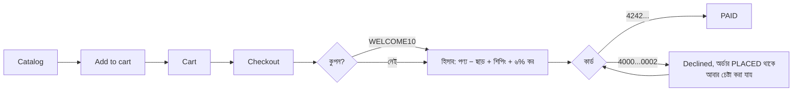

### ৪.৪ অর্ডারের অবস্থা (state machine)

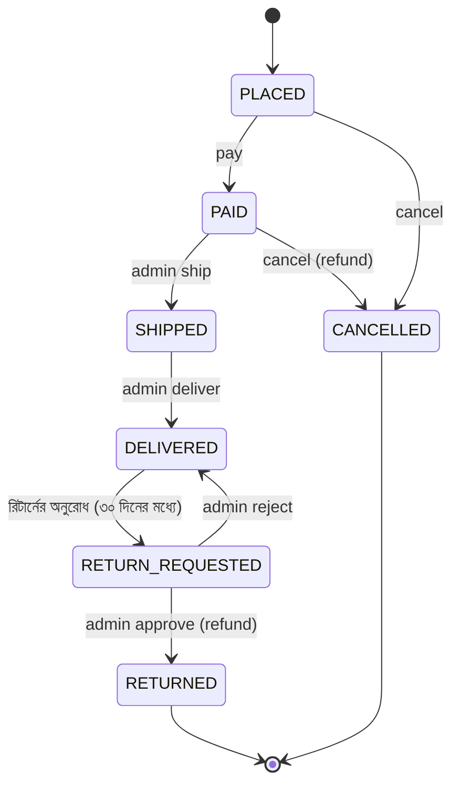

তালিকার বাইরের কোনো পরিবর্তন backend 409 দিয়ে আটকায়। রিভিউ লেখা যায় শুধু কেনা আর DELIVERED পণ্যে (verified buyer)।

### ৪.৫ ভাষা আর help

- Topbar-এর ভাষার তালিকা থেকে বাছুন। পছন্দটা এই ডিভাইসে মনে থাকে।
- আরবিতে পুরো পাতা ডান থেকে বামে ঘোরে।
- পণ্যের নাম, দাম আর অর্ডারের অবস্থা backend থেকে আসে, তাই অনুবাদ হয় না।
- **Help** পাতায় ৯টা বিষয়: শুরু করা, পণ্য খোঁজা, checkout + টেস্ট কার্ড, অর্ডার, রিটার্ন, রিভিউ, নিরাপত্তা, অ্যাডমিন গাইড, ডেস্কটপ + কীবোর্ড।
- উপরের খোঁজার ঘরে লিখলে মিলে যাওয়া বিষয়গুলো দেখায় (যেমন `4242` লিখলে checkout)।
- সরাসরি একটা বিষয়ে যেতে: `#/help/checkout`

---

## ৫. Store admin প্যানেল

অ্যাডমিন হিসেবে লগইন করলে sidebar-এ **Store admin** দেখা যায়। Customer `#/admin`-এ গেলে শুধু "এই অংশ অ্যাডমিনের জন্য" দেখে। আসল সুরক্ষা backend-এ (403)।

| পাতা | ঠিকানা | কাজ |
|---|---|---|
| Dashboard | `#/admin` | মোট অর্ডার, শিপের অপেক্ষায়, আয়, কম স্টক, অপেক্ষমাণ রিটার্ন |
| Products | `#/admin/products` | Add, Edit, Update, Delete, ছবি (Picture), নাম দিয়ে Search, পাতা ভাগ (২৫টা করে), Stock history |
| Coupons | `#/admin/coupons` | নতুন কুপন (PERCENT বা FIXED), তালিকা |
| All orders | `#/admin/orders` | অবস্থা দিয়ে ফিল্টার, অর্ডার নম্বরে খোঁজা, UPS/FedEx/USPS দিয়ে Ship, Mark delivered |
| Returns | `#/admin/returns` | নোট লিখে Approve বা Reject |
| Reviews | `#/admin/reviews` | Hide বা Publish |
| E-mails | `#/admin/notifications` | কাকে কোন ইমেইল গেছে (PENDING / SENT / FAILED), ভুলের কারণ, FAILED-এ **Send again** |

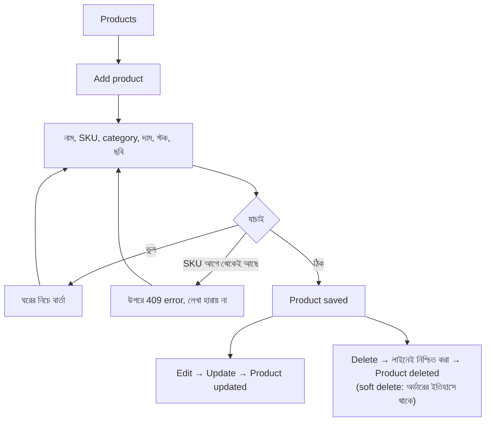

| ফর্ম | নিয়ম |
|---|---|
| Product | নাম আর SKU লাগবেই; দাম > 0, সর্বোচ্চ ২ দশমিক; স্টক ০ বা তার বেশি পূর্ণ সংখ্যা; ছবি খালি, `/products/<নাম>.svg/png/jpg/webp` অথবা `https://` লিংক |
| Coupon | কোডে শুধু অক্ষর, সংখ্যা, `_`, `-`; মান > 0; PERCENT হলে ≤ ১০০; সর্বোচ্চ ব্যবহার ≥ ১ |

> Products-এর খোঁজা শুধু **নাম** মেলায়, SKU না (DEF-023)।

**পণ্যের ছবি**

- সিড করা ৮টা পণ্যের নিজস্ব ছবি আছে: `frontend/public/products/<sku ছোট হাতে>.svg` (যেমন `elec-mouse-001.svg`)। এগুলো এই প্রজেক্টের জন্য আঁকা নিজস্ব SVG, কোনো কপিরাইটের ঝামেলা নেই।
- ছবি না থাকলে বা লিংক লোড না হলে category-র ছবি দেখায়: `electronics.svg`, `home.svg`, `books.svg`, বাকি সবার জন্য `product.svg` (পার্সেল বাক্স)। তাই কখনো ভাঙা ছবির আইকন দেখা যায় না।
- নতুন ছবি দিতে: ফাইলটা `frontend/public/products/`-এ রাখুন (নাম ছোট হাতের অক্ষর, সংখ্যা, `-`), তারপর Products → Edit → **Picture** ঘরে `/products/নাম.png` লিখে Update। অথবা যেকোনো `https://` লিংক। ঘরের পাশে সাথে সাথে preview দেখায়।
- `javascript:`, `data:`, `http://`, `../` বা উদ্ধৃতিচিহ্ন থাকা লিংক browser-এও আটকায়, backend-ও 400 দেয় (XSS আর path traversal ঠেকাতে)। nginx-এর CSP-তে তাই `img-src 'self' data: https:` রাখা হয়েছে।
- সাবধান: Edit করে Picture ঘর খালি করে Update দিলে ছবি মুছে যায় (API-তে `PUT` পুরো পণ্য বদলায়, `imageUrl` না পাঠালে `null`)।

---

## ৬. টেস্ট চালানো

Automation টেস্টের জন্য backend 8081-এ চালু থাকতে হবে। UI আর accessibility টেস্টের জন্য storefront 5173-এও চালু থাকতে হবে। সবচেয়ে সহজ: আগে `docker compose --profile app up -d --build --wait`।

```bash
# Backend
mvn -f backend/pom.xml verify                       # unit + integration + coverage gate (JaCoCo)
mvn -f backend/pom.xml -Pmutation -Djacoco.skip=true test-compile org.pitest:pitest-maven:mutationCoverage

# Automation
mvn -f automation/pom.xml clean test                              # সব (API, DB, BDD, security, UI)
mvn -f automation/pom.xml clean test -DexcludedGroups=ui,mobile          # browser ছাড়া সব
mvn -f automation/pom.xml clean test -Dgroups=ui                  # UI + accessibility, headless Chrome
mvn -f automation/pom.xml clean test -Dgroups=ui -Dbrowser=firefox   # chrome | firefox | edge | safari
mvn -f automation/pom.xml clean test -Dgroups=ui -Dheadless=false    # browser চোখে দেখে
mvn -f automation/pom.xml clean test -Dtest=UiShellTest           # একটা class
mvn -f automation/pom.xml clean test -Dtest='UiAdminProductsTest#productLifecycle'   # একটা টেস্ট
mvn -f automation/pom.xml clean test -Dcucumber.filter.tags="@flagship"              # একটা Cucumber tag
mvn -f automation/pom.xml clean test -DbaseUrl=http://localhost:8081 -DuiUrl=http://localhost:5173
```

- JUnit tag: `ui`, `a11y`, `contract`, `db`, `security`, `concurrency`, `payment`, `returns`
- Cucumber tag: `@smoke`, `@flagship`, `@api`, `@catalog`, `@cart`, `@checkout`, `@order`, `@reviews`, `@wishlist`, `@security`
- `-D` ছাড়া environment variable-ও চলে: `BROWSER=edge HEADLESS=false mvn -f automation/pom.xml test -Dgroups=ui`
- **Safari** (শুধু Mac): একবার `sudo safaridriver --enable` চালান, তারপর Safari → Settings → Advanced → "Show features for web developers" → Develop মেনু → **Allow Remote Automation**। Safari-র headless mode নেই, টেস্টের সময় Mac unlock রাখুন।
- একটা UI টেস্ট প্রথমবার ফেল করে দ্বিতীয়বার পাস করলে রিপোর্টে **FLAKY** লেখা থাকে। এটাও defect হিসেবে দেখা হয়।

### Performance (k6) আর security

```bash
performance/k6run.sh -e DURATION=30s performance/tests/smoke.js
performance/k6run.sh -e BUYERS=60 -e STOCK=15 performance/tests/flash-sale.js
performance/k6run.sh -e DURATION=20s performance/tests/catalog.js
performance/k6run.sh performance/tests/load.js      # লম্বা: load | stress | spike | soak

security/osv-scan.sh                                # SBOM তৈরি করে লাইব্রেরির vulnerability খোঁজে
python3 docs/qa/check_rtm.py                        # প্রতিটা requirement-এর টেস্ট আছে কিনা
```

`k6` install না থাকলে `k6run.sh` নিজেই Docker image (`grafana/k6`) ব্যবহার করে। Mac-এ install: `brew install k6`।

---

## ৭. রিপোর্ট তৈরি আর দেখা

| রিপোর্ট | তৈরি করতে | কোথায় |
|---|---|---|
| Allure (সব automation) | `mvn -f automation/pom.xml allure:serve` | নিজে browser-এ খোলে |
| Allure (ফাইল) | `mvn -f automation/pom.xml allure:report` | `automation/target/allure-report/index.html` |
| Cucumber | automation টেস্ট চালালেই | `automation/target/cucumber-report.html` |
| JaCoCo coverage | `mvn -f backend/pom.xml verify` | `backend/target/site/jacoco/index.html` |
| PIT mutation | ৬ নম্বর অংশের PIT command | `backend/target/pit-reports/index.html` |
| k6 | k6 চালালেই | `performance/reports/<নাম>-report.html` |
| OSV | `security/osv-scan.sh` | `osv-results.json` |
| Jenkins QA Reports | যেকোনো Jenkins build | build-এর পাতায় **QA Reports** |
| GitHub-এর Allure | main-এ merge হলে | https://rbchy.github.io/RbcTcsWorld_ECommerceSuite/ |

- Allure-এর `index.html` ফাইল সরাসরি ডাবল-ক্লিকে খুললে সাদা দেখায় (browser `file://` থেকে ডেটা পড়তে দেয় না)। `allure:serve` ব্যবহার করুন।
- Jenkins-এর QA Reports পাতায় প্রতিটা gate-এর কার্ড থাকে। যে stage চলেনি সেটা "not run" (ধূসর), ফেল করলে লাল। পাতাটা কখনো build-এর চেয়ে বেশি সবুজ দেখায় না (DEF-022)।
- লিখিত QA রিপোর্টগুলো `docs/qa/`-এ: Test Strategy, Test Plan, Risk Register, Traceability Matrix, Defect Reports, Test Summary Report।

---

## ৮. CI/CD: GitHub Actions আর Jenkins

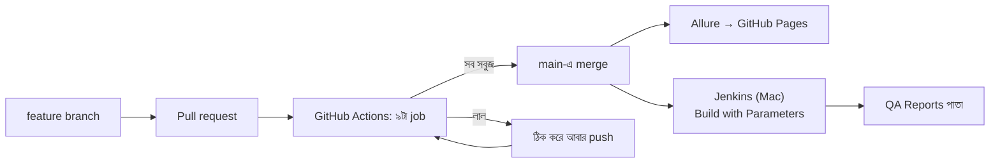

### ৮.১ GitHub Actions

প্রতিটা push আর pull request-এ চলে: backend + coverage, mutation, PostgreSQL-এর উপর API/DB/BDD/UI, Firefox, Edge, ZAP + OSV, Docker smoke, Jenkinsfile lint, Allure publish। এছাড়া একটা "runner canary" নির্ধারিত সময়ে পরের Ubuntu image-এ টেস্ট চালিয়ে আগাম সতর্ক করে।

ফলাফল দেখতে: repo → **Actions** ট্যাব, অথবা pull request-এর নিচে check-এর তালিকা।

### ৮.২ Jenkins (Mac-এ)

```bash
brew install jenkins-lts                 # একবার
brew services start jenkins-lts          # চালু
brew services restart jenkins-lts        # restart
brew services stop jenkins-lts           # বন্ধ
```

Browser থেকে restart: `http://localhost:8080/safeRestart` (চলমান build শেষ হওয়ার পর) অথবা `/restart` (সাথে সাথে)।

**একবারের setup:**

1. **JDK 21:** `brew install --cask temurin@21`, তারপর `/usr/libexec/java_home -v 21` চালিয়ে path বের করুন। Manage Jenkins → Tools → JDK installations → Add JDK: Name `jdk-21`, "Install automatically" বন্ধ, JAVA_HOME-এ **command-এর ফলাফলটা** দিন (command-টা না)।
2. **রিপোর্টের JavaScript চালু** (Allure আর Cucumber সাদা না দেখাতে):
   ```bash
   mkdir -p ~/.jenkins/init.groovy.d
   echo 'System.setProperty("hudson.model.DirectoryBrowserSupport.CSP", "")' > ~/.jenkins/init.groovy.d/report-csp.groovy
   brew services restart jenkins-lts
   ```
3. Plugin: Pipeline, Git, HTML Publisher, JUnit (suggested plugin-এর সাথেই আসে, HTML Publisher আলাদা)।
4. Job: New Item → Pipeline → "Pipeline script from SCM" → Git → repo URL → Script Path `Jenkinsfile`।

**চালানো:** Job → **Build with Parameters**:

| Parameter | মান |
|---|---|
| `RUN_UI` | Selenium UI টেস্ট চালাবে কিনা |
| `BROWSER` | chrome, firefox, edge, safari |
| `RUN_MUTATION` | PIT (প্রায় ৪ মিনিট) |
| `RUN_SECURITY` | OSV + contract + ZAP |
| `K6_EXTRA` | none, load, stress, spike, soak |

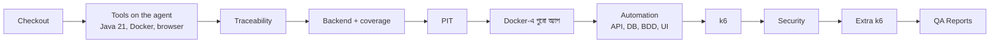

- প্রতিটা stage-এর নিজের সময়সীমা আছে, পুরো build-এর সর্বোচ্চ ১২০ মিনিট।
- একসাথে একটাই build চলে, কারণ port 5432, 8081, 5173 নির্দিষ্ট।
- শেষ ২০টা build রাখা হয়।

---

## ৯. Git: প্রতিদিনের command

```bash
git pull                                   # সর্বশেষ কোড আনা
git checkout -b feature/নতুন-কাজ          # নতুন branch
git add -A && git commit -m "কী বদলালাম"
git push -u origin feature/নতুন-কাজ       # তারপর GitHub-এ pull request খুলুন
git checkout main && git pull              # merge হওয়ার পর main-এ ফেরা
git branch -d feature/নতুন-কাজ            # local branch মোছা
git fetch --prune                          # GitHub-এ মোছা branch-এর তালিকা পরিষ্কার
```

GitHub-এ merge হওয়া branch মুছতে: repo → **Branches** → branch-এর পাশে মোছার আইকন।

---

## ১০. সমস্যা সমাধান: যা আগে হয়েছে

কোনো সমস্যায় পড়লে প্রথমে এই ক্রমে দেখুন:

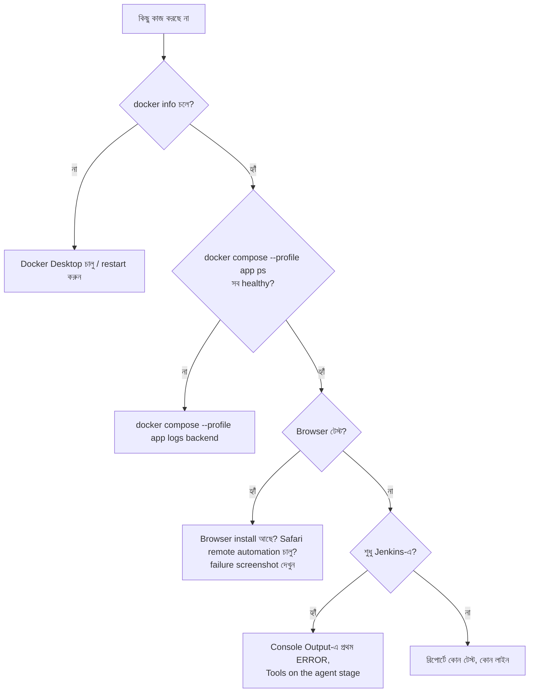

| লক্ষণ | কারণ | সমাধান |
|---|---|---|
| `Cannot connect to the Docker daemon` | Docker Desktop বন্ধ | Docker Desktop খুলুন; বা `open -a Docker` |
| Jenkins: "DOCKER DOES NOT ANSWER" | Docker ঝুলে আছে | Docker Desktop → Quit → আবার চালু |
| Build আধা ঘণ্টার বেশি আটকে | Docker বা Safari উত্তর দিচ্ছিল না | এখন প্রতিটা stage-এর timeout আছে; Docker/Safari ঠিক করে আবার চালান |
| `port is already allocated` (5432/8081/5173) | আগের কোনো অ্যাপ ঐ port-এ | `lsof -i :5432` দেখে বন্ধ করুন; Mac-এ নিজের PostgreSQL থাকলে `brew services stop postgresql` |
| Jenkins-এ Allure/Cucumber সাদা পাতা | Jenkins-এর CSP JavaScript আটকায় | ৮.২-এর ধাপ ২ |
| QA Reports-এ "Not Found" | Resource Root URL ভুল দেওয়া ছিল | Manage Jenkins → Security → Resource Root URL **খালি** রাখুন |
| Build বলে Java 21 না | JDK টুলের JAVA_HOME-এ command লেখা ছিল, path না | `/usr/libexec/java_home -v 21`-এর **ফলাফল** বসান |
| Firefox/Edge build চালুর আগেই থামে | আগের preflight browser না পেলে থামাত | ঠিক করা হয়েছে, এখন শুধু NOTE দেখায় |
| Safari: "SAFARI NOT READY" | Remote automation বন্ধ বা Mac lock | ৬ নম্বর অংশের Safari ধাপ; build-এর সময় Mac unlock |
| Safari: কোনো ঘরে কিছু লেখা হয় না | Cmd+A-র পর Safari Cmd চেপে রাখত (DEF-024) | ঠিক করা হয়েছে, `git pull` |
| QA Reports সবুজ, কিন্তু build ফেল | পুরোনো রিপোর্ট পড়ছিল (DEF-022) | ঠিক করা হয়েছে, build-এর শুরুতে পুরোনো রিপোর্ট মোছে |
| k6 "not run" অথচ চলেছে | রিপোর্টের ফোল্ডার মুছে যেত (DEF-025) | ঠিক করা হয়েছে, `git pull` |
| UI টেস্ট লগইন পাতায় আটকে | token বসানোর পর পাতা reload হতো না | ঠিক করা হয়েছে (`loginWithToken` reload করে) |
| গ্রাহক ইমেইল পাননি | `NOTIFICATIONS_CHANNEL=log` (default) হলে ইমেইল শুধু log-এ যায়; অথবা mail server বন্ধ | Docker-এ http://localhost:8025 দেখুন; admin → E-mails-এ অবস্থা আর ভুলের কারণ; FAILED হলে **Send again** |
| ইমেইল আসতে কয়েক সেকেন্ড লাগে | ইচ্ছাকৃত: outbox প্রতি ২ সেকেন্ডে পাঠায়, checkout অপেক্ষা করে না | স্বাভাবিক; `NOTIFICATIONS_POLL_MS` দিয়ে বদলানো যায় |
| `port 8025/1025 is already allocated` | Mac-এ আরেকটা Mailpit/MailHog চলছে | `brew services stop mailpit`, অথবা compose-এ port বদলান |
| Pay চাপলে 503 "Payment service is not available" | Stripe চালু (`PAYMENT_PROVIDER=stripe`) কিন্তু নেটওয়ার্ক/ key সমস্যা | backend log-এ "Stripe charge ... failed"; key `sk_test_` কিনা দেখুন; একই কার্ডে আবার চাপলে দ্বিতীয়বার টাকা কাটে না |
| Backend চালু হয় না: "Refusing a LIVE Stripe key" | `sk_live_` key `prod` profile ছাড়া | development-এ সবসময় `sk_test_` key |
| লগইন হয় না, 429 | ৫ বার ভুল পাসওয়ার্ডে ১৫ মিনিট লক (Redis-এ, restart-এ খোলে না) | অপেক্ষা করুন; development-এ `docker compose exec redis redis-cli FLUSHALL` |
| `port 6379 is already allocated` | Mac-এ নিজের Redis চলছে | `brew services stop redis`, অথবা compose-এ port বদলান |
| হঠাৎ লগইন পাতা, "Session expired" | refresh token বাতিল (১৪ দিনের মেয়াদ, logout, বা পুরোনো token আবার ব্যবহার) | আবার লগইন করুন |
| Backend log-এ "Redis is not reachable" | Redis বন্ধ | `docker compose up -d redis`; ততক্ষণ login চলে, প্রতিটা backend নিজে গোনে |
| কুপন কাজ করে না | `EXPIRED20`, `FUTURE15`, `DISABLED` ইচ্ছা করেই অচল (টেস্টের জন্য) | `WELCOME10` বা `SAVE5` |
| Mac: "unidentified developer" | Gatekeeper | right-click → Open |
| নতুন কোড দেওয়ার পরও পুরোনো পাতা | browser/service worker cache | Cmd+Shift+R; না হলে DevTools → Application → Service workers → Unregister |
| Admin মেনু দেখা যায় না | customer হিসেবে লগইন | Log out করে অ্যাডমিন দিয়ে লগইন |

---

## ১১. ভবিষ্যতে যে সমস্যা আসতে পারে

| কী হতে পারে | কেন | কী করবেন |
|---|---|---|
| Browser update-এর পর UI টেস্ট শুরুই হয় না | Driver আর browser-এর version মেলে না | Selenium Manager নিজেই নতুন driver আনে; না পারলে `~/.cache/selenium` মুছে আবার চালান; Selenium-এর version বাড়ান |
| "Unable to find CDP implementation" warning | Chrome Selenium-এর চেয়ে নতুন | ক্ষতিকর না, টেস্ট CDP ব্যবহার করে না; Selenium update দিলে চলে যায় |
| macOS update-এর পর Safari টেস্ট বন্ধ | Remote automation আবার বন্ধ হয়ে যেতে পারে | `sudo safaridriver --enable` আর Develop → Allow Remote Automation আবার |
| Docker "no space left on device" | পুরোনো image জমে যায় | `docker system df` দেখুন, `docker system prune -a` (অব্যবহৃত image মোছে) |
| Jenkins-এর disk ভরে যায় | রিপোর্ট আর archive | শেষ ২০টা build রাখা হয়; দরকার হলে `~/.jenkins/jobs/<job>/builds` পরিষ্কার |
| GitHub Actions হঠাৎ লাল, কোড না বদলেও | নতুন runner image বা action-এর version বাতিল | Runner canary আগে সতর্ক করে; workflow-এ version বাড়ান |
| OSV scan নতুন vulnerability দেখায় | নতুন CVE প্রকাশ পায় | `mvn versions:display-dependency-updates`, লাইব্রেরি update করে আবার scan |
| Spring Boot বা Java-র বড় update | API বদলায় | আলাদা branch-এ পুরো regression চালান (DEF-016, DEF-017-এর মতো) |
| Flyway: "checksum mismatch" | আগের migration ফাইল বদলানো হয়েছে | পুরোনো migration কখনো বদলাবেন না, নতুন `V8__...sql` লিখুন; development-এ `docker compose down -v` |
| নতুন ভাষার লেখা ইংরেজিতে দেখায় | `i18n.js`-এ নতুন key-র ৬টা অনুবাদ দেওয়া হয়নি | প্রতিটা key-তে ৬টা মান দিন (en, bn, es, fr, ar, zh) |
| নতুন পাতা আরবিতে উল্টো দেখায় | CSS-এ `left/right` লেখা | `margin-inline`, `inset-inline` ব্যবহার করুন |
| UI টেস্ট মাঝেমধ্যে ফেল (FLAKY) | অপেক্ষা ছাড়া পড়া, re-render | `Thread.sleep` না, `wait.until(...)`; data-testid দিয়ে খোঁজা |
| Installed app নতুন version দেখায় না | পুরোনো service worker | `sw.js`-এ cache-এর নাম বদলান; ব্যবহারকারীকে একবার reload |
| ফোন থেকে খোলে না | Firewall বা ভিন্ন Wi-Fi | একই নেটওয়ার্ক, firewall-এ Docker-কে অনুমতি |
| PIT বা UI টেস্ট বেশি সময় নেয় | টেস্ট বাড়ছে | Jenkins-এ `RUN_MUTATION` বন্ধ রেখে দ্রুত build, রাতে পুরো build |
| Real server-এ deploy | dev পাসওয়ার্ড আর JWT secret সবাই জানে | `ADMIN_EMAIL`, `ADMIN_PASSWORD` আর `JWT_SECRET` environment variable দিয়ে বদলান; HTTPS ব্যবহার করুন |
| ৩০ সেকেন্ড পরেও পুরোনো refresh token ফেরত আসে (খুব ধীর নেটওয়ার্ক) | Grace period শেষ, তাই চুরি ধরা হয় | ব্যবহারকারী আবার লগইন করেন; দরকারে `REFRESH_GRACE_SECONDS` বাড়ান |
| Redis-এর memory ভরে যায় | খুব বেশি আলাদা ইমেইলে আক্রমণ | `maxmemory 64mb` + `volatile-ttl`: সবচেয়ে আগে মেয়াদ শেষ হবে এমন key আগে যায় |
| আসল ইমেইল সেবা (SES, SendGrid, Gmail) | এখনকার SMTP-তে login আর TLS নেই | port 587 + STARTTLS + username/password যোগ করতে হবে (`SmtpMailChannel`) |
| Stripe API-র নতুন version | stripe-mock-এর version pin করা (`v0.206.0`) | নতুন version-এ contract টেস্ট চালিয়ে তারপর pin বদলান |
| Stripe-এ পরে refund/dispute হলে দোকান জানে না | webhook নেই | `/api/stripe/webhook` + signature যাচাই (পরের কাজ) |
| Redis-এ password বা TLS লাগবে (cloud) | Production Redis খোলা থাকে না | `REDIS_URL=rediss://:password@host:6380` (Lettuce নিজেই বোঝে) |
| Token চুরির ঝুঁকি (XSS) | token `localStorage`-এ | কড়া CSP আছে; পরের ধাপ: refresh token HttpOnly cookie-তে |

---

## ১২. দ্রুত command তালিকা (cheat sheet)

```bash
# অ্যাপ
docker compose --profile app up -d --build --wait     # চালু
docker compose --profile app down                     # বন্ধ
docker compose --profile app down -v                  # বন্ধ + database নতুন
docker compose --profile app logs -f backend          # log

# টেস্ট
mvn -f backend/pom.xml verify
mvn -f automation/pom.xml clean test
mvn -f automation/pom.xml clean test -Dgroups=ui -Dbrowser=safari -Dheadless=false
mvn -f automation/pom.xml allure:serve

# Performance + security
performance/k6run.sh -e DURATION=30s performance/tests/smoke.js
security/osv-scan.sh

# Jenkins
brew services start jenkins-lts
brew services restart jenkins-lts
/usr/libexec/java_home -v 21

# Git
git pull
git checkout -b feature/x && git push -u origin feature/x

# ইমেইল (Mailpit)
open http://localhost:8025                                               # inbox
curl -s http://localhost:8025/api/v1/messages | head -c 400              # API দিয়ে

# Stripe test mode-এ চালানো (key: stripe.com → Developers → API keys)
PAYMENT_PROVIDER=stripe STRIPE_SECRET_KEY=sk_test_... mvn -f backend/pom.xml spring-boot:run

# Redis (login lockout)
docker compose exec redis redis-cli --scan --pattern 'rbc:login:*'   # কোন কোন lock/counter আছে
docker compose exec redis redis-cli FLUSHALL                         # development-এ সব lock খোলা

# খুঁজে দেখা
lsof -i :8081            # কে port ব্যবহার করছে
docker system df         # Docker কত জায়গা নিচ্ছে
ipconfig getifaddr en0   # Mac-এর IP (ফোন থেকে খুলতে)
```

**আরও বিস্তারিত:** [Stripe আর ইমেইল](modules/PAYMENTS_NOTIFICATIONS_BN.md) · [Login, session, Redis](modules/AUTH_SESSIONS_BN.md) · [Storefront UI](modules/STOREFRONT_UI_BN.md) · [CI/CD + Jenkins](modules/CICD_BN.md) · [Performance](modules/PERFORMANCE_K6_BN.md) · [Security](modules/SECURITY_BN.md) · [Allure](modules/ALLURE_REPORT_BN.md) · [Defect Reports](qa/DEFECT_REPORTS.md)
