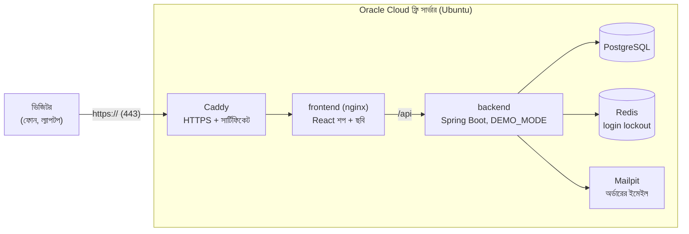

# Live demo: Oracle Cloud-এর ফ্রি সার্ভারে শপ চালানো (ধাপে ধাপে)

এই গাইড শেষ করলে শপটা ইন্টারনেটে একটা `https://` লিংকে সবসময় চালু থাকবে। Mac বন্ধ থাকলেও, যেকোনো ফোন বা কম্পিউটার থেকে খোলা যাবে। লিংকটা resume, LinkedIn আর GitHub profile-এ দেওয়া যায়।

- **খরচ:** Oracle-এর "Always Free" সীমার মধ্যে থাকলে শূন্য। জুন ২০২৬ থেকে ARM সার্ভারের সীমা ২ OCPU আর ১২ GB RAM; এই শপের জন্য তা যথেষ্ট। Oracle নিয়ম বদলাতে পারে, তাই সাইন-আপের সময় তাদের পাতায় একবার দেখে নেবেন।
- **সময়:** প্রথমবার ১–২ ঘণ্টা। বেশিরভাগ সময় যায় account খোলা আর প্রথম build-এ।
- **যা লাগবে:** একটা ইমেইল, একটা ফোন নম্বর, আর একটা ক্রেডিট/ডেবিট কার্ড। কার্ড শুধু পরিচয় যাচাইয়ের জন্য; Always Free জিনিস ব্যবহার করলে টাকা কাটে না।

---

## কাঠামো: কী কোথায় চলে



- ইন্টারনেট থেকে শুধু **Caddy**-তে পৌঁছানো যায় (port 80 আর 443)। Database, Redis, backend বাইরে থেকে একদম বন্ধ।
- **Caddy** নিজেই Let's Encrypt থেকে ফ্রি HTTPS সার্টিফিকেট আনে আর সময়মতো নতুন করে।
- ঠিকানা ফ্রি: সার্ভারের IP `129.146.10.20` হলে ঠিকানা হবে `https://129-146-10-20.sslip.io`। আলাদা domain কিনতে হয় না।

**Demo mode (`DEMO_MODE=true`)-এ যা বদলায়:**

| নিয়ম | কেন |
|---|---|
| উপরে হলুদ ফিতা: "ডেমো শপ, কিছুই আসল না, টেস্ট কার্ড 4242..." | কেউ যেন আসল কার্ড নম্বর না দেয় |
| GitHub-এ লেখা JWT secret বা `Admin@12345` থাকলে backend **চালুই হয় না** | একটা setting ভুলে গেলে সেটা যেন live-এ না যায় |
| পণ্যের ছবি শুধু `/products/...`, বাইরের `https://` লিংক না | পাবলিক পাতায় অজানা ছবি দেখানো ঠেকাতে |
| পেমেন্ট শুধু mock (টেস্ট কার্ড), সার্ভারে কোনো Stripe key নেই | টাকা লেনদেনের কোনো সম্ভাবনাই নেই |
| প্রতি রাত ৩:৩০-এ সব reset | ভিজিটরদের account, অর্ডার আর বদল মুছে শপ আবার নতুনের মতো হয় |

---

## ধাপ ১: Oracle Cloud account খোলা

1. Browser-এ যান **https://www.oracle.com/cloud/free/** → **Start for free**।
2. দেশ, নাম, ইমেইল দিন। ইমেইলে আসা লিংকে ক্লিক করে যাচাই করুন।
3. পাসওয়ার্ড আর **Cloud Account Name** দিন (যেমন `rbchy`)। এটা পরে লগইনে লাগবে।
4. **Home Region** সাবধানে বাছুন। **পরে আর বদলানো যায় না।** Pennsylvania থেকে কাছের: **US East (Ashburn)**।
5. ফোন নম্বর আর কার্ড দিয়ে যাচাই করুন। সাময়িকভাবে ছোট একটা অঙ্ক "hold" দেখাতে পারে, পরে ফেরত যায়।
6. Account চালু হতে কয়েক মিনিট লাগতে পারে। "Your account is ready" ইমেইল এলে **Sign in** করুন।

---

## ধাপ ২: Mac-এ SSH key বানানো (সার্ভারে ঢোকার চাবি)

Mac-এর Terminal-এ:

```bash
ssh-keygen -t ed25519 -f ~/.ssh/oracle_demo -C "rbctcsworld-demo"
```

- Passphrase চাইলে একটা দিন (অথবা Enter চেপে খালি রাখুন)।
- দুটো ফাইল তৈরি হয়:
  - `~/.ssh/oracle_demo`: **গোপন চাবি**। কাউকে দেবেন না, GitHub-এ তুলবেন না।
  - `~/.ssh/oracle_demo.pub`: **public চাবি**। এটা Oracle-কে দেবেন।

Public চাবিটা দেখতে:

```bash
cat ~/.ssh/oracle_demo.pub
```

পুরো লাইনটা (`ssh-ed25519 AAAA... rbctcsworld-demo`) কপি করে রাখুন।

---

## ধাপ ৩: সার্ভার (VM) তৈরি

Oracle Cloud console-এ:

1. বাম উপরের মেনু (☰) → **Compute** → **Instances** → **Create instance**।
2. **Name:** `rbctcsworld-demo`
3. **Image and shape** → **Edit**:
   - **Image:** **Change image** → **Ubuntu** → **Canonical Ubuntu 24.04** → Select।
   - **Shape:** **Change shape** → **Ampere** → **VM.Standard.A1.Flex** → OCPU **2**, Memory **12 GB** → Select।
   - পাশে "Always Free-eligible" লেখা আছে কি না দেখুন।
4. **Networking:**
   - "Create new virtual cloud network" আর "Create new public subnet" রাখুন।
   - **Assign a public IPv4 address**: **Yes** রাখুন।
5. **Add SSH keys:** **Paste public keys** বেছে ধাপ ২-এর লাইনটা পেস্ট করুন।
6. **Boot volume:** যেমন আছে তেমনই রাখুন (৫০ GB, ফ্রি সীমার মধ্যে)।
7. **Create** চাপুন। ১–২ মিনিটে অবস্থা **RUNNING** হবে।
8. Instance-এর পাতায় **Public IP address** লিখে রাখুন (যেমন `129.146.10.20`)।

> **"Out of capacity for shape VM.Standard.A1.Flex"** দেখালে: ফ্রি ARM সার্ভারের চাহিদা বেশি। Placement-এ অন্য **Availability domain** বেছে আবার চেষ্টা করুন, অথবা কয়েক ঘণ্টা পর। এটা আপনার ভুল না।

---

## ধাপ ৪: Oracle-এর firewall-এ port 80 আর 443 খোলা

Oracle-এ দুটো firewall আছে: নেটওয়ার্কের **Security List** আর সার্ভারের নিজের। দ্বিতীয়টা ধাপ ৬-এর script নিজেই খোলে। প্রথমটা console-এ খুলতে হয়:

1. Instance-এর পাতায় **Primary VNIC** অংশে **Subnet**-এর লিংকে ক্লিক করুন।
2. **Security Lists** → **Default Security List for ...**।
3. **Add Ingress Rules**:
   - Source CIDR: `0.0.0.0/0`
   - IP Protocol: **TCP**
   - Destination Port Range: `80`
   - **Add Ingress Rules**
4. একইভাবে আরেকটা নিয়ম যোগ করুন, port `443`।

Port 22 (SSH) আগে থেকেই খোলা থাকে।

---

## ধাপ ৫: সার্ভারে ঢোকা

Mac-এর Terminal-এ (IP আপনারটা দিন):

```bash
ssh -i ~/.ssh/oracle_demo ubuntu@129.146.10.20
```

প্রথমবার "Are you sure you want to continue connecting?" জিজ্ঞেস করলে `yes` লিখুন। Prompt `ubuntu@rbctcsworld-demo:~$` দেখালে আপনি সার্ভারের ভেতরে আছেন।

---

## ধাপ ৬: এক command-এ সার্ভার প্রস্তুত করা

সার্ভারের ভেতরে চালান:

```bash
curl -fsSL https://raw.githubusercontent.com/rbchy/RbcTcsWorld/main/deploy/setup-vm.sh | bash
```

`deploy/setup-vm.sh` এগুলো করে:
1. Docker আর git install করে।
2. সার্ভারের নিজের firewall-এ 80 আর 443 খোলে।
3. প্রজেক্ট নামায় `~/RbcTcsWorld`-এ।
4. `deploy/.env` লেখে: random database পাসওয়ার্ড, JWT secret, admin পাসওয়ার্ড, আর sslip.io ঠিকানা।
5. রাত ৩:৩০-এর reset চালু করে।

শেষে এরকম দেখাবে:

```
   demo address : https://129-146-10-20.sslip.io
   store admin  : admin@rbctcsworld.com / Demo-3f9a1c7b2e01!   <- write this down
```

**Admin পাসওয়ার্ডটা লিখে রাখুন** (Password manager বা Notes)। পরে দেখতে চাইলে: `cat ~/RbcTcsWorld/deploy/.env`।

তারপর একবার বেরিয়ে আবার ঢুকুন, যাতে Docker-এর অনুমতি চালু হয়:

```bash
exit
ssh -i ~/.ssh/oracle_demo ubuntu@129.146.10.20
```

---

## ধাপ ৭: শপ চালু করা

```bash
~/RbcTcsWorld/deploy/deploy.sh
```

- প্রথমবার **১০–১৫ মিনিট** লাগে, কারণ সার্ভারে Java আর React build হয়। পরের বার অনেক কম।
- শেষে `deploy/smoke.sh` নিজে থেকে চলে আর বাইরে থেকে ১৫টা জিনিস যাচাই করে:

```
Smoke test of https://129-146-10-20.sslip.io
  ok    storefront answers over HTTPS
  ok    storefront is the demo build (ribbon)
  ok    HSTS header
  ...
Smoke test passed
```

---

## ধাপ ৮: খুলে দেখা

যেকোনো browser, ফোন বা iPad-এ খুলুন: **`https://129-146-10-20.sslip.io`** (আপনার IP দিয়ে)।

- উপরে হলুদ "ডেমো শপ" ফিতা, পণ্যের ছবি, Log out/Exit বোতাম দেখবেন।
- Admin প্যানেল: ধাপ ৬-এর পাসওয়ার্ড দিয়ে লগইন করুন।
- iPhone-এ Safari → Share → **Add to Home Screen**। এবার HTTPS আছে, তাই app-এর মতো আলাদা window-এ খোলে।

---

## ধাপ ৯: GitHub-কে লিংক জানানো (প্রতিদিনের স্বয়ংক্রিয় যাচাই)

1. GitHub-এ repo → **Settings** → **Secrets and variables** → **Actions** → **Variables** ট্যাব → **New repository variable**।
2. Name: `DEMO_URL`, Value: `https://129-146-10-20.sslip.io` → **Add variable**।
3. **Actions** ট্যাব → **Live demo check** → **Run workflow**।

এরপর থেকে GitHub প্রতিদিন সকালে (New York সময় ৯:১৭) demo-টা বাইরে থেকে পরীক্ষা করে। কিছু ভাঙলে workflow লাল হয় আর GitHub আপনাকে ইমেইল পাঠায়।

---

## নতুন কোড live-এ পাঠানো (প্রতিবার merge-এর পর)

```bash
ssh -i ~/.ssh/oracle_demo ubuntu@129.146.10.20
~/RbcTcsWorld/deploy/deploy.sh
```

`deploy.sh` নতুন কোড নামায়, যা বদলেছে শুধু তা আবার build করে, চালু করে, আর smoke test চালায়। Database-এর ডেটা থেকে যায়, আর নতুন Flyway migration নিজে থেকেই চলে।

---

## দরকারি command (সার্ভারের ভেতরে)

```bash
cd ~/RbcTcsWorld
DC="docker compose -f deploy/docker-compose.yml --env-file deploy/.env"

$DC ps                          # কোন container চলছে, healthy কিনা
$DC logs backend --tail=100     # backend-এর শেষ log
$DC logs caddy --tail=50        # HTTPS/সার্টিফিকেটের log
$DC restart backend             # শুধু backend আবার চালু
deploy/reset-demo.sh            # এখনই reset (রাতের মতো)
tail ~/reset-demo.log           # রাতের reset-এর ফলাফল
free -h ; df -h /               # RAM আর disk
```

**অর্ডারের ইমেইল দেখা (Mailpit):** এটা ইচ্ছা করেই ইন্টারনেটে খোলা না। Mac-এর Terminal থেকে tunnel খুলুন:

```bash
ssh -i ~/.ssh/oracle_demo -L 8025:localhost:8025 ubuntu@129.146.10.20
```

তারপর Mac-এর browser-এ **http://localhost:8025**।

---

## সমস্যা হলে

| কী দেখছেন | কারণ | কী করবেন |
|---|---|---|
| "Out of capacity" | ফ্রি ARM সার্ভার সাময়িকভাবে শেষ | অন্য Availability domain, বা কয়েক ঘণ্টা পর আবার |
| `ssh: Connection timed out` | ভুল IP, অথবা সার্ভার বন্ধ | Console-এ instance **RUNNING** কিনা আর Public IP দেখুন |
| `Permission denied (publickey)` | ভুল চাবি | `-i ~/.ssh/oracle_demo` দিয়েছেন কিনা; user নাম `ubuntu` |
| Browser-এ সাইট খোলে না | Security List-এ 80/443 খোলা হয়নি | ধাপ ৪ আবার দেখুন; সার্ভারে `sudo iptables -L INPUT -n` চালিয়ে 80/443-এর ACCEPT দেখুন |
| সার্টিফিকেট error / Caddy log-এ "challenge failed" | Let's Encrypt port 80 দিয়ে পৌঁছাতে পারেনি | ধাপ ৪-এর port **80**-এর নিয়ম; তারপর `$DC restart caddy` |
| `permission denied ... docker.sock` | Docker group এখনো চালু হয়নি | `exit` করে আবার ssh |
| deploy.sh: "Refusing to start: ... JWT secret / admin password" | `deploy/.env`-এ secret নেই বা development-এর মান | `deploy/.env` দেখুন; ফাঁকা থাকলে `rm deploy/.env` করে `setup-vm.sh` আবার চালান |
| Build খুব ধীর বা থেমে যায় | প্রথম Java build-এ RAM লাগে | `free -h`; Shape-এ ১২ GB আছে কিনা দেখুন |
| Smoke test-এ একটা লাইন FAIL | ঐ লাইনের জিনিসটা ঠিক কাজ করছে না | লাইনের নামটা আর `$DC logs backend --tail=100` আমাকে পাঠান |
| কিছুদিন পর সার্ভার বন্ধ পাওয়া গেল | Oracle-এর নিয়মে খুব কম ব্যবহৃত Always Free সার্ভার ফেরত নিতে পারে | Console-এ instance আবার **Start**; বারবার হলে account "Pay As You Go"-তে upgrade করা যায় (Always Free সীমার মধ্যে খরচ শূন্যই থাকে) |

---

## নিরাপত্তা: মনে রাখার কথা

- **Admin পাসওয়ার্ড কাউকে দেবেন না, README-তেও লিখবেন না।** Recruiter-রা নিজে customer account খুলে কেনাকাটা করে দেখতে পারবেন। Admin প্যানেল দেখাতে চাইলে screenshot বা ছোট ভিডিও দিন।
- `deploy/.env` আর `~/.ssh/oracle_demo` কখনো GitHub-এ যাবে না। `.env` এমনিতেই `.gitignore`-এ আছে।
- সার্ভারে Ubuntu-র নিরাপত্তা update মাসে একবার দিন: `sudo apt update && sudo apt upgrade -y && sudo reboot`। Reboot-এর পর শপ নিজে থেকেই চালু হয় (`restart: unless-stopped`)।
- Demo-তে কেউ আসল কার্ড দিলেও কিছু হয় না: শুধু mock gateway আছে, কার্ড নম্বর কখনো সংরক্ষণ হয় না, আর রাতে সব মুছে যায়।

---

## CI-তে কীভাবে যাচাই হয়

প্রতিটা push-এ GitHub-এর **"Public demo stack (HTTPS, demo safeguards, nightly reset)"** job এই একই `deploy/docker-compose.yml` চালায়। Caddy সেখানে নিজের local সার্টিফিকেট ব্যবহার করে। Job এগুলো যাচাই করে:

1. 80/443 ছাড়া কোনো port বাইরে খোলা নেই।
2. JWT secret না দিলে backend সত্যিই চালু হয় না।
3. `deploy/smoke.sh` পুরোটা পাস করে।
4. বাইরের ছবির লিংক 400 পায়।
5. একজন ভিজিটর রেজিস্টার করার পর `reset-demo.sh` চালালে সে মুছে যায়, আর শপ আবার পুরো ঠিক থাকে।

তাই সার্ভারে যা চলবে, সেটা প্রতিটা build-এ আগেই পরীক্ষা হয়ে যায়।
