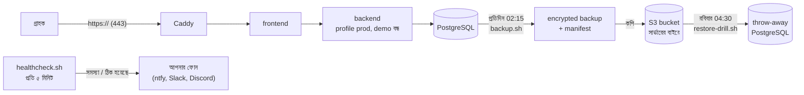

# আসল দোকানের সার্ভার (Phase 5): চালু করা, backup, ফেরত আনা, alert

Demo সার্ভার ([ORACLE_CLOUD_BN.md](ORACLE_CLOUD_BN.md)) প্রতি রাতে নিজেকে মুছে ফেলে। আসল দোকানে উল্টোটা দরকার:
অর্ডার, পেমেন্ট আর ট্যাক্সের হিসাবই ব্যবসা। তাই আসল দোকান চলে আলাদা একটা stack-এ:
- প্রতিদিন encrypted backup, সার্ভারের বাইরে কপি
- প্রতি সপ্তাহে নিজে নিজে "ফেরত আনার মহড়া" (restore drill)
- প্রতি ৫ মিনিটে স্বাস্থ্য পরীক্ষা, সমস্যা হলে আপনার ফোনে খবর

কেন এভাবে: [ADR-0016](../adr/0016-production-stack-backups-and-alerts.md)।

## কাঠামো



| | Demo সার্ভার | আসল দোকান |
|---|---|---|
| Compose ফাইল | `deploy/docker-compose.yml` | `deploy/production/docker-compose.yml` |
| Spring profile | – (DEMO_MODE=true) | `prod` (live Stripe key শুধু এখানেই চলে) |
| উপরে হলুদ ফিতা | আছে | নেই |
| ইমেইল | Mailpit (সার্ভারের ভেতরে) | Amazon SES (domain verify হওয়া পর্যন্ত log) |
| রাতে মুছে ফেলা | হ্যাঁ | **কখনো না** |
| Backup, মহড়া, alert | নেই | আছে |
| ভুলে যাওয়া setting | default দিয়ে চলে | **চালুই হয় না** |

Demo আর আসল দোকান দুটোই port 80/443 চায়, তাই আসল দোকান **আলাদা সার্ভারে** চালান।
Oracle-এর Always Free-এ একাধিক VM বানানো যায়, অথবা মাসে $10–25-এর একটা VPS নিন।

## ১. প্রথমবার (একবারই)

1. **Domain:** DNS-এ একটা `A` record দিন, `your-store.com` → সার্ভারের IP। চাইলে `www.your-store.com`-ও একই IP-তে।
2. **সার্ভারে:**
   ```bash
   git clone https://github.com/rbchy/RbcTcsWorld.git ~/RbcTcsWorld
   ~/RbcTcsWorld/deploy/production/setup-prod.sh
   ```
   এই script যা করে:
   - Docker, jq আর openssl install করে
   - firewall-এ শুধু 80 আর 443 খোলে
   - নিরাপত্তা update স্বয়ংক্রিয় করে
   - এলোমেলো গোপন মান দিয়ে `deploy/production/.env` লেখে
   - cron-এ তিনটা কাজ বসায়: backup, স্বাস্থ্য পরীক্ষা, মহড়া
3. **`.env` পূরণ:** `nano ~/RbcTcsWorld/deploy/production/.env`
   - `STORE_DOMAIN`, `ADMIN_EMAIL` বসান।
   - **`BACKUP_PASSPHRASE` আর `ADMIN_PASSWORD` এখনই password manager-এ কপি করুন।**
     passphrase হারালে কোনো backup আর কখনো খোলা যাবে না।
   - Stripe, Tax, Shippo আর SES চালু করবেন একটা একটা করে, আগে test mode-এ। প্রতিটার গাইড `docs/modules/`-এ।
4. **Backup রাখার bucket (সার্ভারের বাইরে):**
   - **Oracle Object Storage** (Always Free-এ ২০ GB পর্যন্ত):
     1. Object Storage → *Create bucket*, যেমন `rbctcsworld-backups`।
     2. নিজের Profile → *Customer secret keys* → *Generate*। এটা S3-এর access key আর secret।
     3. `.env`-এ বসান:
        ```bash
        BACKUP_S3_BUCKET=rbctcsworld-backups
        BACKUP_S3_ENDPOINT=https://<namespace>.compat.objectstorage.<region>.oraclecloud.com
        BACKUP_S3_REGION=<region>
        BACKUP_S3_ACCESS_KEY=...
        BACKUP_S3_SECRET_KEY=...
        ```
   - অথবা AWS S3 বা Backblaze B2: একই variable, AWS হলে `BACKUP_S3_ENDPOINT` খালি থাকবে।
   - Bucket-এ একটা **lifecycle rule** দিন: ৯০ দিনের পুরোনো backup মুছে যাবে।
5. **Alert:**
   - ফোনে **ntfy** app install করুন। একটা লম্বা এলোমেলো topic নামে subscribe করুন, তারপর `.env`-এ বসান:
     `ALERT_WEBHOOK_URL=https://ntfy.sh/<সেই-topic>`
   - Slack বা Discord webhook URL-ও চলে।
   - **বাইরে থেকেও একটা পাহারা দিন:** পুরো সার্ভার বন্ধ হয়ে গেলে সার্ভার নিজে খবর দিতে পারে না।
     UptimeRobot (ফ্রি)-এ `https://your-store.com/healthz` প্রতি ৫ মিনিটে দেখার monitor বানান।
6. **চালু করুন:** `~/RbcTcsWorld/deploy/production/deploy-prod.sh`
   - শেষে বাইরে থেকে smoke test চলে, "Smoke test passed" দেখা উচিত।

## ২. প্রতিদিনের কাজ: কিছুই না

| কখন | কী চলে | ফল কোথায় |
|---|---|---|
| প্রতিদিন 02:15 | `backup.sh` | `~/backups/backup.log`, আর bucket-এ নতুন ফাইল |
| প্রতি ৫ মিনিট | `healthcheck.sh` | `~/backups/health.log`; সমস্যা হলে আর ঠিক হলে ফোনে একবার করে খবর |
| রবিবার 04:30 | `restore-drill.sh` | `~/backups/drill.log`; ব্যর্থ হলে ফোনে খবর |

Alert আসে এসব ক্ষেত্রে:
- দোকান বা API সাড়া দিচ্ছে না
- কোনো container অসুস্থ
- disk ৮৫%-এর বেশি ভরা
- ২৬ ঘণ্টায় কোনো সফল backup হয়নি
- HTTPS certificate-এর মেয়াদ ১৪ দিনের কম

একই সমস্যা চলতে থাকলে বারবার নয়, একবারই খবর আসে। ঠিক হলে আবার একবার খবর আসে।

## ৩. Update

শুধু চালান: `~/RbcTcsWorld/deploy/production/deploy-prod.sh`

এটা আগে একটা backup নেয়, তারপর নতুন কোড আনে, build করে, সব container সুস্থ হওয়া পর্যন্ত অপেক্ষা করে, শেষে smoke test চালায়।
Update-এ কিছু ভাঙলে ঠিক আগের backup থেকে ফেরত আনা যায়।

## ৪. বিপদে: ফেরত আনা

- **ভুল update বা ভুল করে data মুছে গেছে:**
  ```bash
  ls ~/backups/*.dump.enc                      # কোন backup-এ ফিরবেন
  ~/RbcTcsWorld/deploy/production/restore.sh rbctcsworld-20261101T021500Z.dump.enc
  ```
  - script জিজ্ঞেস করবে, `RESTORE` লিখে নিশ্চিত করুন।
  - ওই backup-এর পরের সব অর্ডার হারাবে। তাই Stripe Dashboard থেকে মাঝের পেমেন্টগুলো মিলিয়ে নিন।
- **পুরো সার্ভার নেই** (মুছে গেছে, নষ্ট):
  1. নতুন সার্ভার বানিয়ে ধাপ ১ করুন।
  2. পুরোনো `.env`-এর মানগুলো password manager থেকে বসান, বিশেষ করে `BACKUP_PASSPHRASE` আর bucket-এর key।
  3. `deploy-prod.sh` চালান, তারপর:
     ```bash
     ~/RbcTcsWorld/deploy/production/restore.sh --latest-offsite
     ```
  4. DNS-এর `A` record নতুন IP-তে বদলান।
- **নিজে একবার মহড়া দিন (প্রতি ৩ মাসে):** `restore-drill.sh --from-offsite`। bucket থেকে নামিয়ে আলাদা database-এ ফেরত আনে, আসল দোকানে হাত দেয় না।

## ৫. প্রতিটা অংশ কীভাবে প্রমাণিত

প্রতি push-এ CI job **"Production stack"** পুরো ব্যাপারটা আসল ধাপগুলো দিয়ে চালায়:

| ধাপ | প্রমাণ |
|---|---|
| Stack চালু | profile prod, শুধু 80/443 খোলা, হলুদ ফিতা নেই; একটা দরকারি setting বাদ দিলে চালু হয় না |
| Backup | একজন গ্রাহকের অর্ডারসহ backup: ফাইলটা encrypted, ভেতরে খোলা dump নেই, manifest-এ ঠিক সংখ্যা, S3 bucket-এ (MinIO) পাওয়া যায় |
| মহড়া | একটা byte নষ্ট করা ফাইল বাতিল হয় আর alert যায়; bucket-এর কপি থেকে মহড়া পাস করে |
| ফেরত আনা | backup-এর পরে খোলা account ফেরত আনার পরে আর থাকে না, আগের গ্রাহক থাকে |
| স্বাস্থ্য পরীক্ষা | সব ঠিক থাকলে চুপ; একটা container বন্ধ করলে একটাই alert; আবার চালু করলে "Recovered" |

Requirement: NFR-OPS-05, NFR-OPS-06, NFR-OPS-07 ([traceability](../qa/TRACEABILITY_MATRIX.md))।
