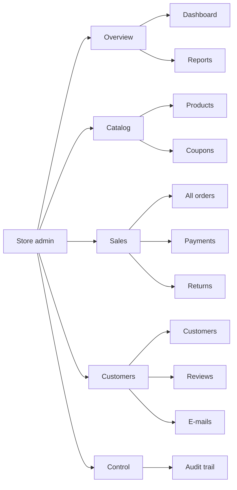

# Store admin back office: banner, menu, গ্রাহক, কুপন, রিপোর্ট, পেমেন্ট, advanced search

একটা আসল e-commerce সফটওয়্যারে admin-এর যা যা লাগে, এই অংশে সেগুলো যোগ হয়েছে। প্রতিটা form-এ দুই জায়গায় validation আছে: browser-এ (সাথে সাথে বার্তা) আর server-এ (চূড়ান্ত বিচারক)। সব পাতা ৬ ভাষায় চলে।

## Menu আর sub-menu

প্রতিটা ভাগ (▾) চাপলে ভাঁজ হয়ে যায়। শুরুতে সব খোলা থাকে, যাতে পুরোনো টেস্টগুলো আগের মতোই লিংক খুঁজে পায়।

## Banner আর watermark

- **Login পাতা:** বাঁ দিকে একটা "gate pass" banner (harbor-নীল, পাশে কমলা container-এর দাগ, নিচে barcode)। উপরে হালকা করে বাঁকা **RbcTcsWorld** watermark। ডান দিকে login form। ফোনে banner ছোট হয়ে form-এর উপরে বসে।
- **Dashboard:** তারিখ, "Signed in as ...", watermark, আর তিনটা দ্রুত কাজের বোতাম: পণ্য যোগ, অর্ডার পাঠানো (কয়টা বাকি), রিপোর্ট।
- Watermark একটা **background ছবি**, লেখা নয়। তাই screen reader এটা পড়ে না, copy-paste-এ আসে না, আর accessibility-র রঙ যাচাইয়েও (axe) সমস্যা হয় না।

## প্রতিটা টেবিলের কাজ

| টেবিল | Entry | Edit | Browse / Display | Search | Report |
|---|---|---|---|---|---|
| products | ✅ | ✅ | ✅ | ✅ নাম + category + দামের range + শুধু স্টকে আছে + sort | কম স্টক, স্টকের মূল্য, সেরা বিক্রিত |
| coupons | ✅ | ✅ **নতুন** (code বদলায় না) + চালু / বন্ধ | ✅ মেয়াদ, অবস্থা | ✅ **নতুন** code + অবস্থা | কুপনের ব্যবহার |
| users (গ্রাহক) | গ্রাহক নিজে register করেন | ✅ **নতুন** চালু / বন্ধ | ✅ **নতুন** তালিকা + বিস্তারিত | ✅ **নতুন** ইমেইল, অবস্থা, ৫ রকম sort | - |
| orders | গ্রাহক checkout করেন | ship / deliver | ✅ | ✅ **নতুন** তারিখ, মোট টাকার range, courier, কুপন + CSV | বিক্রি, অবস্থা অনুযায়ী অর্ডার |
| payment_transactions | পেমেন্টের সময় নিজে লেখা হয় | কখনো না | ✅ **নতুন** Payments পাতা | ✅ **নতুন** তারিখ, ধরন, ফলাফল, অর্ডার নম্বর | চার্জ, রিফান্ড, নিট |
| return_requests | গ্রাহক | approve / reject | ✅ | ✅ অবস্থা | রিটার্ন (কারণ অনুযায়ী) |
| reviews, notifications, audit_log | - | যেমন ছিল | ✅ | ✅ | audit CSV |

## গুরুত্বপূর্ণ নিয়ম আর কেন

| নিয়ম | কেন |
|---|---|
| গ্রাহক বন্ধ করলে সাথে সাথে বের হয়ে যায়: access token প্রত্যাখ্যাত, refresh token বাতিল, login-এ 403 | fraud বা অপব্যবহার হলে ১৫ মিনিট অপেক্ষা করা চলে না |
| "account বন্ধ" বার্তা শুধু **সঠিক password** দেওয়ার পর | নইলে কেউ বুঝে যেত কোন ইমেইলের account আছে |
| Store admin-কে গ্রাহক তালিকায় দেখানো হয় না, বন্ধও করা যায় না | নিজেকে বা অন্য admin-কে ভুল করে আটকে ফেলা যাবে না |
| বন্ধ করার আগে একবার নিশ্চিত করতে হয় (Confirm / Cancel) | ভুল ক্লিকে কারো account বন্ধ না হয় |
| কুপনের code বদলানো যায় না; maxUses ব্যবহৃত সংখ্যার কম হতে পারে না | পুরোনো অর্ডার আর গ্রাহক ওই code ব্যবহার করে; database-এর CHECK-ও ভাঙবে না |
| ইমেইল খোঁজায় `%` আর `_` সাধারণ অক্ষর (LIKE escape) | "a_b" খুঁজলে ঠিক "a_b"-ই আসবে |
| রিপোর্টে "প্রাপ্ত টাকা" = PAID, SHIPPED, DELIVERED, RETURN_REQUESTED, **পেমেন্টের দিনে** গোনা | বাতিল আর ফেরত অর্ডারের টাকা ফেরত গেছে, ধরা হলে হিসাব ভুল হতো |
| তারিখের সীমা ১ থেকে ৩৬৬ দিন, শুরু ≤ শেষ | বিশাল query দিয়ে server ধীর করা যাবে না |
| খালি দিনগুলোও রিপোর্টে থাকে (০) | chart-এ ফাঁক থাকলে প্রবণতা ভুল দেখায় |
| CSV-তে `= + - @` দিয়ে শুরু লেখার আগে `'`; সংখ্যা সংখ্যাই থাকে | CSV injection বন্ধ, আবার Excel-এ যোগফলও করা যায় |
| কুপন আর গ্রাহকের প্রতিটা পরিবর্তন audit trail-এ যায় | কে কবে কী বদলেছে পরে প্রমাণ করা যায় |

## রিপোর্টগুলো

| রিপোর্ট | কী দেখায় | বিশেষ বিকল্প |
|---|---|---|
| Sales | প্রতিদিন বা প্রতি মাসে অর্ডার, পণ্য, subtotal, ছাড়, shipping, tax, মোট + bar chart | দিন / মাস |
| Best sellers | কোন পণ্য কত বিক্রি হলো, কত টাকা এলো | কতগুলো (১-১০০) |
| Orders by status | জীবনচক্রের ক্রমে প্রতিটা অবস্থায় কত অর্ডার | - |
| Returns | কারণ আর সিদ্ধান্ত অনুযায়ী, কত রিফান্ড, কত স্টকে ফেরত | - |
| Coupon use | প্রতিটা কুপন কতবার, কত ছাড় দিয়েছে | - |
| Low stock | এখন কোন পণ্যের স্টক কম (তারিখ লাগে না) | স্টক সর্বোচ্চ (০-১০০০) |
| Stock value | category অনুযায়ী তাকের মালের দাম | - |

প্রতিটা রিপোর্টে **Download CSV** আর **Print** আছে। Print করলে menu আর বোতাম লুকিয়ে যায়; শুধু RbcTcsWorld-এর নাম, watermark, রিপোর্টের নাম, সময়কাল আর টেবিল ছাপা হয়।

## API

| Endpoint | কাজ |
|---|---|
| `GET /api/admin/customers?q&status&sort&page&size` | গ্রাহক তালিকা |
| `GET /api/admin/customers/{id}` | বিস্তারিত (অর্ডার, শেষ ঠিকানা) |
| `POST /api/admin/customers/{id}/disable` / `enable` | বন্ধ / চালু |
| `GET /api/admin/coupons?q&status` | কুপন খোঁজা |
| `PUT /api/admin/coupons/{id}` | কুপন edit |
| `POST /api/admin/coupons/{id}/disable` / `enable` | বন্ধ / চালু |
| `GET /api/admin/reports` , `/{name}`, `/{name}/export` | রিপোর্ট, CSV |
| `GET /api/admin/payments?from&to&type&status&q&page&size` | পেমেন্ট খাতা |
| `GET /api/products?category&minPrice&maxPrice&inStock` | advanced search (পুরোনো client-এর জন্য কিছু ভাঙে না) |
| `GET /api/products/categories` | category তালিকা |

## টেস্ট (RTM: REQ-ADM-01 থেকে REQ-ADM-08)

| স্তর | ফাইল |
|---|---|
| Unit | `CustomerServiceTest`, `CouponServiceTest`, `ReportServiceTest`, `PaymentLedgerServiceTest`, `ProductServiceTest`, `AuthServiceTest`, `CsvTest` (যেখানে SQL আছে, সেখানে আসল SQL H2-তে চলে) |
| Integration | `AdminCustomersCouponsIntegrationTest`, `ReportsIntegrationTest`, `ProductSearchIntegrationTest` |
| API (REST Assured) | `AdminSuiteApiTest` |
| UI | `playwright/tests/admin-suite.spec.ts` (Chromium, Firefox, WebKit; login banner ফোনেও), `AccessibilityTest` এখন **২২টা পাতা** |
| Mutation | নতুন সব `*Service` আর `Csv` PIT-এর আওতায় |

## ইন্টারভিউয়ে কীভাবে বলবেন

*"I completed the back office the way a real store needs it: customer management with an immediate lock-out, coupon editing, seven reports with CSV and print, a payment ledger and advanced search. Every form validates in the browser and on the server, every change is audited, and each requirement is traced to unit, integration, API and UI tests."*
