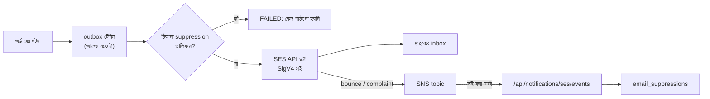

# Amazon SES: দোকানের নিজের domain থেকে ইমেইল (দোকানের Phase 3, শেষ অংশ)

আগে অর্ডারের ইমেইল যেত Mailpit-এ (টেস্টে) বা শুধু log-এ। এখন `NOTIFICATIONS_CHANNEL=ses` দিলে ইমেইল যায়
Amazon SES দিয়ে, দোকানের নিজের domain থেকে (যেমন `orders@your-store.com`)। কোনো ঠিকানা থেকে ইমেইল ফেরত এলে
বা কেউ spam বললে, সেই ঠিকানায় আর পাঠানো হয় না।
কেন এই সিদ্ধান্ত: [ADR-0014](../adr/0014-amazon-ses-mail.md)।

## কীভাবে কাজ করে



- **outbox বদলায়নি।** আগের মতোই প্রতিটা ইমেইল একবার যায়, ব্যর্থ হলে 30 সেকেন্ড, 1, 2, 4 মিনিট পরে আবার চেষ্টা হয়, তারপর FAILED।
- **AWS SDK নেই।** SES-এর API সরাসরি HTTPS দিয়ে ডাকা হয়, সই (AWS Signature V4) নিজের ছোট class-এ।
  সেই সই AWS-এর নিজের Python SDK (botocore)-এর বের করা সইয়ের সাথে মেলানো হয়েছে (`AwsSigV4Test`)।
- **কে রিপোর্ট পাঠাতে পারে:** শুধু Amazon SNS। প্রতিটা বার্তায় SNS-এর সই থাকে, আর সেই সইয়ের certificate আসতে হবে
  `https://sns.<region>.amazonaws.com` থেকে। অন্য topic বা সই ছাড়া বার্তা 400; topic সেট না থাকলে 503।
- **শুধু স্থায়ী bounce (ঠিকানাই নেই) আর complaint** তালিকায় ওঠে। "Mailbox full"-এর মতো সাময়িক bounce-এ কিছু বদলায় না।

## ধাপে ধাপে সেটআপ (domain কেনার পরে)

### ১. SES-এ domain যোগ করা
1. AWS Console → **Amazon SES** → region বেছে নিন (যেমন `us-east-1`) → **Identities → Create identity → Domain**।
2. **Easy DKIM** (RSA 2048) চালু রাখুন। SES ৩টা CNAME record দেবে, সেগুলো domain-এর DNS-এ বসান।
3. **Custom MAIL FROM domain** দিন, যেমন `mail.your-store.com`। SES একটা MX আর একটা TXT (SPF) record দেবে, সেগুলোও বসান।
4. DNS-এ একটা DMARC record যোগ করুন (প্রথমে শুধু নজর রাখার জন্য):

| Type | Name | Value |
|---|---|---|
| CNAME ×3 | `xxxx._domainkey.your-store.com` | SES যা দেয় (`xxxx.dkim.amazonses.com`) |
| MX | `mail.your-store.com` | `10 feedback-smtp.us-east-1.amazonses.com` |
| TXT | `mail.your-store.com` | `"v=spf1 include:amazonses.com ~all"` |
| TXT | `_dmarc.your-store.com` | `"v=DMARC1; p=none; rua=mailto:dmarc@your-store.com"` |

কয়েক মিনিট থেকে কয়েক ঘণ্টা পরে identity-তে **Verified** দেখাবে।

### ২. Sandbox থেকে বের হওয়া
নতুন SES account "sandbox"-এ থাকে: শুধু verified ঠিকানায় পাঠানো যায়, দিনে ২০০টা। **Account dashboard → Request production access**
থেকে আবেদন করুন: লিখুন এটা শুধু অর্ডারের transactional ইমেইল, bounce আর complaint স্বয়ংক্রিয়ভাবে বন্ধ করা হয়।

### ৩. পাঠানোর জন্য IAM user
IAM → Users → Create user (যেমন `rbctcsworld-ses`), শুধু এই permission দিন, তারপর access key বানান:
```json
{ "Version": "2012-10-17",
  "Statement": [{ "Effect": "Allow", "Action": "ses:SendEmail", "Resource": "*" }] }
```

### ৪. Bounce আর complaint রিপোর্ট
1. **SNS → Topics → Create topic** (Standard), নাম যেমন `rbctcsworld-ses-events`। ARN কপি করুন।
2. **SES → Configuration sets → Create** (যেমন `rbctcsworld-events`) → **Event destinations → Add** → event: *Hard bounces* আর *Complaints* → destination: ওই SNS topic।
3. দোকান ইন্টারনেটে চালু হলে: SNS topic → **Create subscription** → Protocol **HTTPS** →
   Endpoint `https://<আপনার-domain>/api/notifications/ses/events`। দোকান নিজেই subscription confirm করে নেবে।

### ৫. দোকানের `.env`
```bash
NOTIFICATIONS_CHANNEL=ses
MAIL_FROM=RbcTcsWorld Shop <orders@your-store.com>
SES_REGION=us-east-1
AWS_ACCESS_KEY_ID=AKIA...
AWS_SECRET_ACCESS_KEY=...
SES_CONFIGURATION_SET=rbctcsworld-events
SES_SNS_TOPIC_ARN=arn:aws:sns:us-east-1:123456789012:rbctcsworld-ses-events
```
region, key বা sender ঠিক না থাকলে backend চালুই হয় না: যে দোকান অর্ডারের ইমেইল পাঠাতে পারে না, সেটা খোলা উচিত নয়।

### ৬. পরীক্ষা
SES-এর নিজের পরীক্ষার ঠিকানায় অর্ডার দিন:
- `success@simulator.amazonses.com`: ইমেইল যায়।
- `bounce@simulator.amazonses.com`: স্থায়ী bounce। কিছুক্ষণ পরে ঠিকানাটা `email_suppressions` টেবিলে উঠবে।
- `complaint@simulator.amazonses.com`: complaint, একইভাবে তালিকায় ওঠে।
Admin → Notifications পাতায় পরের ইমেইলগুলো FAILED দেখাবে, কারণসহ: "Not sent: the address is on the suppression list after a bounce"।

### ৭. বন্ধ ঠিকানা দেখা আর আবার চালু করা

Admin → Notifications পাতার নিচে **Blocked e-mail addresses** তালিকা: কোন ঠিকানা, কেন (Bounced মানে mailbox নেই বা ভরা; Spam complaint মানে গ্রাহক ইমেইলকে spam বলেছেন), SES-এর বিস্তারিত, আর তারিখ। উপরের ঘরে ঠিকানার অংশ লিখে খোঁজা যায়।

- গ্রাহক ফোন বা contact form-এ বললেন "ইমেইল পাচ্ছি না, এখন mailbox ঠিক আছে": ঠিকানার পাশে **Allow again** → নিশ্চিত করুন। পরের ইমেইল থেকে আবার যাবে। আগের FAILED ইমেইল দরকার হলে outbox-এ **Send again** চাপুন।
- আবার bounce হলে SES নিজেই ঠিকানাটা তালিকায় ফিরিয়ে দেবে, তাই ভুল করে চালু করলেও ক্ষতি নেই।
- **Spam complaint** ঠিকানা শুধু গ্রাহক নিজে লিখিতভাবে চাইলে চালু করুন। বারবার complaint হলে Amazon SES account আটকে দিতে পারে।

## এখনো বাকি

- ইমেইল শুধু সাধারণ লেখা (plain text), HTML design নেই।
- domain কেনা হয়নি: `MAIL_FROM` এখনো placeholder।

## টেস্ট কোথায়

| স্তর | টেস্ট | কী প্রমাণ করে |
|---|---|---|
| Unit | `AwsSigV4Test` | সই AWS-এর Python SDK-র সইয়ের সাথে হুবহু মেলে (স্থায়ী আর সাময়িক key) |
| Unit | `SesMailChannelTest` | SES-এ কী যায়, প্রতিটা ভুলের উত্তর, চালু হওয়ার নিয়ম |
| Unit | `SnsMessageVerifierTest` | openssl দিয়ে সই করা বার্তা গ্রহণ, যেকোনো বদলে বাতিল, অন্য host-এর certificate বাতিল |
| Unit | `SesEventControllerTest`, `NotificationDeliveryServiceTest` | কোন রিপোর্ট তালিকায় তোলে, তালিকার ঠিকানায় পাঠানো হয় না |
| Integration | `SesEventsIntegrationTest` | API আর database দিয়ে পুরো পথ |
| Integration | `EmailSuppressionAdminIntegrationTest` | admin তালিকা দেখে, খোঁজে, আবার চালু করে; অন্য কেউ পারে না (REQ-NTF-07) |
| Security | `AccessControlMatrixTest` | topic ছাড়া সবার জন্য 503 |

Requirement: REQ-NTF-05 আর REQ-NTF-06 ([traceability](../qa/TRACEABILITY_MATRIX.md))।
