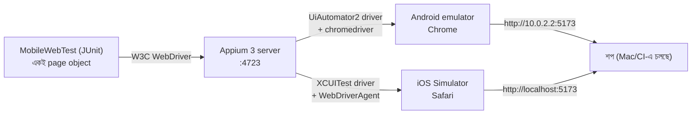

# Appium: আসল ফোনের browser-এ শপ টেস্ট করা

Playwright-এর "Pixel 7" আর "iPhone 14" হলো desktop browser-কে ফোনের মাপে চালানো (emulation)। Appium চালায় **আসল ফোনের browser**: Android emulator বা ফোনের Chrome, আর iOS Simulator বা iPhone-এর Safari। Touch keyboard, ফোনের নিজের Chrome আর Safari, আসল রেন্ডারিং: সব সত্যিকারের।

## কীভাবে কাজ করে



- **কোনো নতুন library লাগেনি।** Appium একই W3C WebDriver ভাষায় কথা বলে, তাই `DriverFactory` শুধু Appium-এর capabilities দিয়ে একটা `RemoteWebDriver` খোলে। ফলে `HomePage`, `LoginPage`, `CheckoutPage`-এর মতো সব page object ফোনেও হুবহু চলে।
- Mobile web-এর জন্য `java-client` দরকার হয় না। Native app (APK/IPA) টেস্ট করতে হলে তখন `AndroidDriver`/`IOSDriver` লাগত।
- Android emulator-এর ভেতর থেকে আপনার কম্পিউটারের ঠিকানা হলো **`10.0.2.2`**। iOS Simulator কম্পিউটারের নেটওয়ার্কই ব্যবহার করে, তাই সেখানে `localhost`।

## টেস্টগুলো (`automation/.../tests/mobile/MobileWebTest.java`, ট্যাগ `mobile`)

| টেস্ট | কী প্রমাণ করে |
|---|---|
| `catalogOnAPhone` | পাতা স্ক্রিনের চেয়ে চওড়া না, ছবি ফোনের browser-এ সত্যিই লোড হয়, Exit শুধু আইকন, search কাজ করে |
| `purchaseOnAPhone` | ফোনের keyboard দিয়ে রেজিস্ট্রেশন → ২টা পণ্য → WELCOME10 → $57.24 → 4242 কার্ড → PAID |
| `menuLogoutAndExitOnAPhone` | "Menu" বোতামে মেনু খোলে; মেনু থেকে Log out, তারপর Exit → goodbye পাতা |
| `reallyAPhone` | Browser-এর user agent-এ সত্যিই "Android"/"iPhone" আছে, ঠিক ঠিকানায় খুলেছে |

এই টেস্টগুলো সাধারণ `mvn test`-এ চলে না (`pom.xml`: `excludedGroups=mobile`), কারণ Appium আর ফোন লাগে। চালাতে হয় `-Dgroups=mobile -DexcludedGroups=none` দিয়ে।

## CI-তে (প্রতিটা push-এ)

| Job | কোথায় |
|---|---|
| **Appium - Chrome on an Android emulator** | Ubuntu runner, KVM, Pixel 6 emulator, Android 14 (Google APIs image), Appium 3.8 + UiAutomator2 8.7 |
| **Appium - Safari on an iOS Simulator** | macOS runner, সবচেয়ে নতুন iPhone simulator, Appium 3.8 + XCUITest 12.13 |

ব্যর্থ হলে artifact-এ থাকে: `appium.log`, screenshot (Allure) আর backend log।

---

## Mac-এ চালানো: Android (Chrome)

**একবারের প্রস্তুতি:**

1. **Android Studio** install করুন: https://developer.android.com/studio
2. Android Studio → **More Actions → Virtual Device Manager → Create device** → **Pixel 6** → system image **API 34, Google APIs** (ARM Mac-এ arm64-v8a) → Finish।
3. Terminal-এ `adb` আর Appium:
   ```bash
   echo 'export ANDROID_HOME=$HOME/Library/Android/sdk' >> ~/.zshrc
   echo 'export PATH=$ANDROID_HOME/platform-tools:$ANDROID_HOME/emulator:$PATH' >> ~/.zshrc
   source ~/.zshrc
   npm install -g appium@3.8.0
   appium driver install uiautomator2@8.7.0
   ```

**প্রতিবার চালাতে:**

```bash
# ১. শপ চালু (desktop launcher, অথবা)
cd ~/Eclipse-Workspace-QA/RbcTcsWorld_ECommerceSuite && docker compose --profile app up -d

# ২. Emulator চালু (Virtual Device Manager-এ ▶, অথবা)
emulator -avd Pixel_6_API_34 &
adb wait-for-device

# ৩. নতুন Terminal tab-এ Appium
appium --allow-insecure '*:chromedriver_autodownload'

# ৪. আরেকটা tab-এ টেস্ট
mvn -f automation/pom.xml test -Dgroups=mobile -DexcludedGroups=none -Dbrowser=android-chrome \
    -DuiUrl=http://10.0.2.2:5173
```

Emulator-এর পর্দায় দেখবেন Chrome নিজে থেকে শপ খুলছে, লেখা টাইপ হচ্ছে, কেনাকাটা হচ্ছে।

**আসল Android ফোনে:**
1. ফোনে **Settings → About phone → Build number** ৭ বার চাপুন। তাতে Developer options চালু হয়।
2. Developer options-এ **USB debugging** চালু করে USB দিয়ে Mac-এ লাগান। `adb devices`-এ ফোন দেখা যাবে।
3. ফোন আর Mac একই Wi-Fi-তে থাকলে `-DuiUrl=http://<Mac-এর IP>:5173` দিন (`ipconfig getifaddr en0`)।

## Mac-এ চালানো: iPhone (Safari)

**একবারের প্রস্তুতি:**

1. App Store থেকে **Xcode** install করুন (বড়, প্রায় ১০ GB)। একবার খুলে license মেনে নিন।
2. Terminal-এ:
   ```bash
   sudo xcode-select -s /Applications/Xcode.app
   xcrun simctl list devices available | grep iPhone      # কোন iPhone simulator আছে
   appium driver install xcuitest@12.13.3
   ```

**প্রতিবার চালাতে:**

```bash
open -a Simulator                     # একটা iPhone simulator খোলে
appium                                # নতুন tab
mvn -f automation/pom.xml test -Dgroups=mobile -DexcludedGroups=none -Dbrowser=ios-safari \
    -DuiUrl=http://localhost:5173
```

প্রথম session-এ Appium **WebDriverAgent** build করে, তাই ২–৫ মিনিট লাগে। পরের বার দ্রুত হয়।

কোন simulator চালাবে নিজে বলে দিতে চাইলে UDID দিন: `-DdeviceId=<UDID>` (UDID পাবেন `xcrun simctl list devices`-এ)।

**আসল iPhone-এ:** WebDriverAgent আপনার Apple ID দিয়ে sign করতে হয় (Xcode → Signing; ফ্রি Apple ID-তেও চলে, ৭ দিন পরপর নতুন করে sign লাগে)। Portfolio-র জন্য simulator-ই যথেষ্ট।

---

## সমস্যা হলে

| কী দেখছেন | কারণ | কী করবেন |
|---|---|---|
| `Could not start a new session ... ECONNREFUSED 4723` | Appium চালু নেই | আলাদা tab-এ `appium` |
| `No Chromedriver found that can automate Chrome 1xx` | Chrome-এর সাথে মেলা chromedriver নেই | Appium চালান `--allow-insecure '*:chromedriver_autodownload'` দিয়ে |
| Android-এ "Welcome to Chrome" পাতায় আটকে | Chrome-এর প্রথমবারের পর্দা | একবার হাতে "Accept & continue" চাপুন, অথবা CI script-এর মতো `chrome-command-line`-এ `--disable-fre` |
| Android-এ "This site can't be reached" | `localhost` দিয়েছেন | Emulator-এ `10.0.2.2`, আসল ফোনে Mac-এর IP |
| iOS: `xcodebuild failed with code 65` | WebDriverAgent build হয়নি (Xcode/signing) | Xcode একবার খুলে license; `appium driver doctor xcuitest` |
| iOS: session তৈরি হতে অনেক সময় | প্রথমবার WDA build হয় | স্বাভাবিক; timeout ৫ মিনিট রাখা আছে |
| `mvn test`-এ mobile টেস্ট চলেনি | ইচ্ছা করেই বাদ | `-Dgroups=mobile -DexcludedGroups=none` |

## Interview-এ বলার মতো

> "একই page object দিয়ে desktop browser, Android Chrome আর iOS Safari টেস্ট করি। Appium W3C WebDriver বলে, তাই mobile web-এর জন্য আলাদা framework লাগেনি, শুধু capabilities আলাদা। CI-তে প্রতিটা push-এ একটা Android emulator আর একটা iOS simulator-এ পুরো কেনাকাটা চলে। Playwright-এর device emulation দ্রুত ফিডব্যাক দেয়, আর Appium আসল ফোনের browser-এ সেটা নিশ্চিত করে।"
