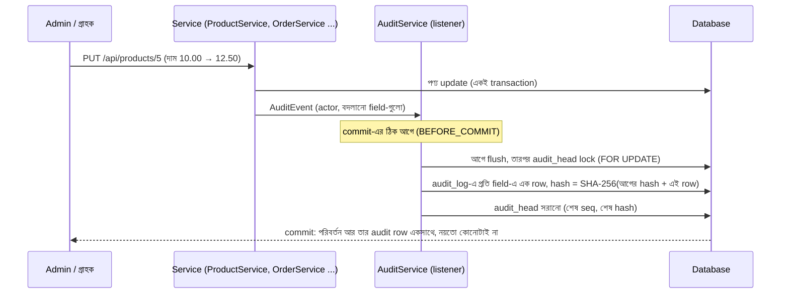

# Audit trail: কে, কখন, কী থেকে কী বদলেছে

Store admin এখন **Audit trail** পাতায় দেখতে পান: কোন পণ্যের দাম, স্টক, নাম ইত্যাদি কে বদলেছেন, আর প্রতিটা অর্ডারের অবস্থা (PLACED → PAID → SHIPPED ...) কে, কখন বদলেছেন। প্রতিটা এন্ট্রি **শুধু যোগ করা যায়**: বদলানো বা মোছা যায় না। পুরো trail একটা **hash chain**, তাই কেউ database-এ ঢুকে চুপচাপ কিছু বদলালেও "Check integrity" সেটা ধরে ফেলে।

> **শব্দচয়ন (ইন্টারভিউয়ে গুরুত্বপূর্ণ):** এই feature **21 CFR Part 11 আর ALCOA+ থেকে অনুপ্রাণিত**। এটা "Part 11 compliant" নয়। Compliance মানে validated system, SOP, electronic signature, training, প্রতিষ্ঠানের audit। এগুলো code দিয়ে একা হয় না। ইন্টারভিউয়ে বলুন: *"I built an audit trail inspired by Part 11 / ALCOA+ principles"*।

## কীভাবে কাজ করে

## নিয়ম আর কেন

| নিয়ম | কেন (ALCOA+) |
|---|---|
| প্রতি বদলানো field-এ এক row: actor, সময়, পুরোনো ও নতুন মান | **Attributable, Contemporaneous, Original**: কে, কখন, আগে কী ছিল |
| শুধু যা সত্যিই বদলেছে (12.5 আর 12.50 একই দাম) | গোলমাল ছাড়া পরিষ্কার trail |
| Audit লেখা হয় একই transaction-এ, commit-এর ঠিক আগে | পরিবর্তন rollback হলে audit row-ও থাকে না; audit লিখতে ব্যর্থ হলে পরিবর্তনও হয় না |
| Database trigger: audit_log-এ UPDATE / DELETE / TRUNCATE নিষেধ | **Enduring, Accurate**: application-এ bug থাকলেও ইতিহাস বদলানো যায় না |
| Hash chain + head | কেউ trigger বন্ধ করে row বদলালে, মাঝের row মুছলে বা শেষের row কেটে দিলে "Check integrity" প্রথম ভাঙা এন্ট্রির নম্বর বলে |
| Hash-এর ভেতরে প্রতিটা অংশ "length:value" | "ab"+"c" আর "a"+"bc" কখনো একই hash দেয় না |
| শুধু store admin পড়তে পারেন (`/api/admin/**`) | গ্রাহক 403, login ছাড়া 401 |
| CSV export-এ `= + - @` দিয়ে শুরু মানের আগে `'` | **CSV injection** (OWASP): Excel-এ খুললে formula চলবে না |
| head row সবসময় **শেষ lock** | দুটো transaction একে অপরের জন্য অপেক্ষা করে আটকে যায় না (deadlock নেই) |

কী audit হয় না (সচেতন সিদ্ধান্ত): অর্ডারের কারণে স্টক কমা/বাড়া। সেটা আগে থেকেই `stock_movements` টেবিলে প্রতিটা অর্ডার নম্বরসহ লেখা থাকে।

## API

| Endpoint | কী করে |
|---|---|
| `GET /api/admin/audit?entityType=PRODUCT&entityId=5&actor=a@b.com&limit=200` | নতুন থেকে পুরোনো; সব filter ঐচ্ছিক; limit 1-1000 (না হলে 400) |
| `GET /api/admin/audit/verify` | `{valid, entries, brokenAtSeq, reason}` |
| `GET /api/admin/audit/export?...` | `audit-trail.csv` ডাউনলোড (পুরোনো থেকে নতুন) |

## টেস্ট (RTM: REQ-AUD-01 থেকে REQ-AUD-04)

| স্তর | ফাইল | কী প্রমাণ করে |
|---|---|---|
| Unit | `AuditChainTest` | জানা SHA-256 মান; প্রতিটা field hash-এ আছে; বদলানো, মোছা, শেষ কাটা row ধরা পড়ে |
| Unit | `AuditChangeTest` | শুধু বদলানো field; নতুন পণ্যে সব মান; actor = login করা মানুষ বা "system" |
| Unit (আসল SQL, H2) | `AuditServiceTest` | chain লেখা, flush-এর পরে lock, filter, limit, CSV, formula নিরাপদ করা |
| Unit | `ProductServiceTest`, `OrderServiceTest`, `FulfillmentServiceTest`, `ReturnServiceTest` | প্রতিটা পরিবর্তনে ঠিক AuditEvent |
| Integration (Spring + H2) | `AuditIntegrationTest` | পুরো API দিয়ে: row লেখা হয়; 409 হলে row নেই; trigger UPDATE/DELETE আটকায়; tamper ধরা পড়ে; 403/401; CSV |
| API (REST Assured) | `AuditApiTest` | চলমান backend-এ একই নিয়ম |
| Database (PostgreSQL) | `AuditDatabaseTest` | আসল PostgreSQL trigger UPDATE, DELETE, TRUNCATE ফিরিয়ে দেয় (চেষ্টাটা rollback হয়) |
| UI | `playwright/tests/audit.spec.ts`, `AccessibilityTest` (১৮টা পাতা) | filter, Check integrity, CSV ডাউনলোড; WCAG 2.1 AA |
| Mutation | PIT: `AuditService`, `AuditChain`, `AuditChange` | টেস্টগুলো সত্যিই ভুল ধরে |

## নিজে চেষ্টা করুন

1. Admin হিসেবে login → **Products** → কোনো পণ্যের দাম বদলান।
2. **Audit trail** → Record: Product, ID দিন → **Show**। দেখবেন `price 10.00 → 12.50`, আপনার ইমেইল, সময়।
3. **Check integrity** → "Intact: all N entries match their hash chain."
4. **Download CSV** → Excel-এ খুলুন।
5. (শুধু local, শেখার জন্য) PostgreSQL-এ `UPDATE audit_log SET new_value='x' WHERE seq=1;` চালান → error: *audit_log is append-only*।

## ইন্টারভিউয়ে কীভাবে বলবেন

*"For data integrity I added an append-only audit trail inspired by 21 CFR Part 11 and ALCOA+. Every product and order-status change is written in the same transaction, one row per field with who, when, old and new value. A database trigger refuses updates and deletes, and a SHA-256 hash chain makes tampering detectable. I proved it at unit, integration, API, database and UI level, including a test that disables the trigger, edits a row and checks that verification points to that exact row."*
