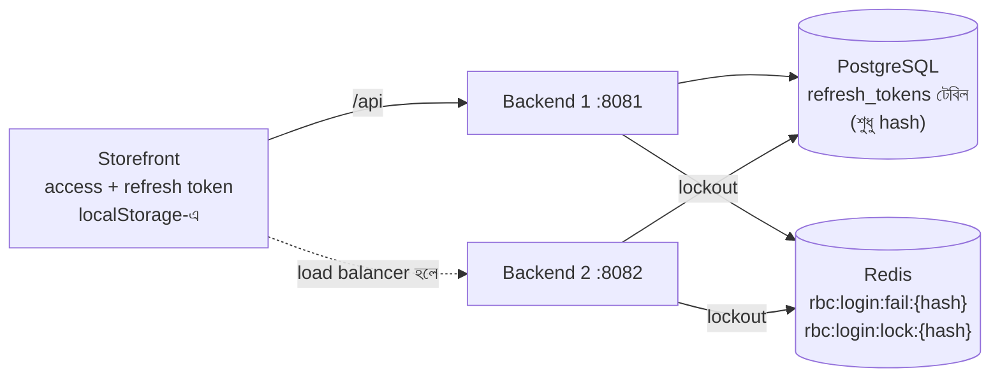
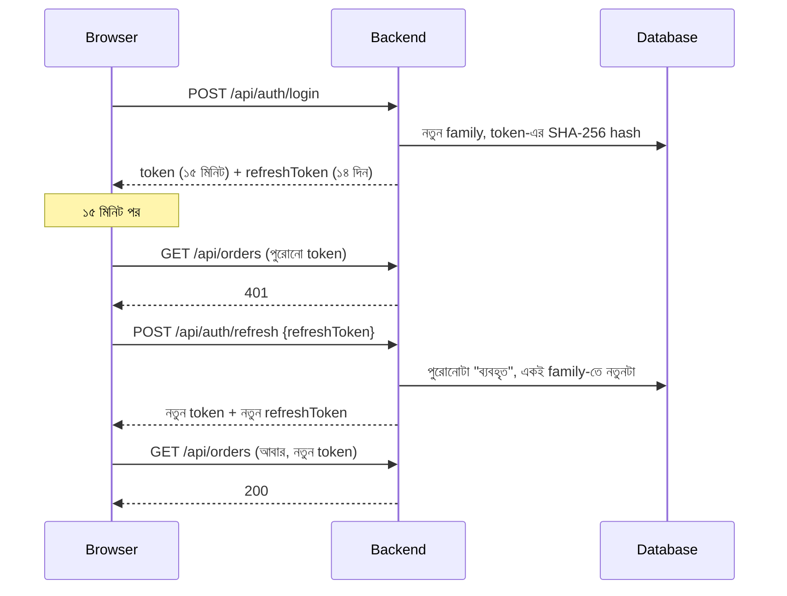
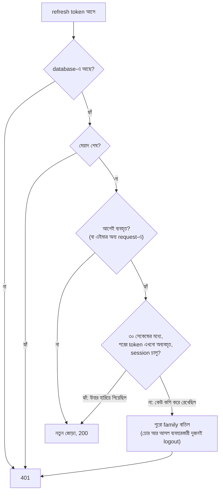
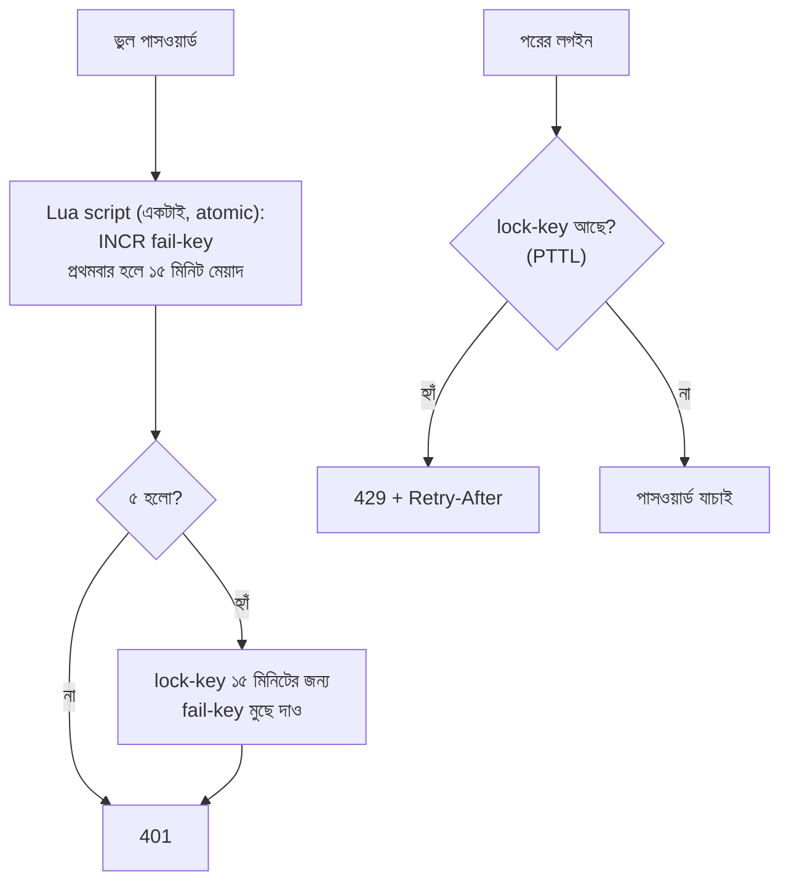

# Login session: refresh token আর Redis দিয়ে login lockout

এই ধাপে দুটো জিনিস যোগ হয়েছে:

1. **Refresh token:** access token এখন ১৫ মিনিটের। একটা ১৪ দিনের refresh token দিয়ে নতুন access token নেওয়া হয়, তাই ব্যবহারকারীকে বারবার লগইন করতে হয় না।
2. **Redis-এ login lockout:** ভুল পাসওয়ার্ডের হিসাব সব backend মিলে একটাই, আর restart দিলেও হারায় না।

## ১. আগে কী ছিল, কেন বদলানো

| আগে | সমস্যা | এখন |
|---|---|---|
| ১ ঘণ্টার একটাই token | চুরি হলে ১ ঘণ্টা ব্যবহার করা যায়; logout শুধু browser থেকে মুছত | ১৫ মিনিটের access token + ১৪ দিনের refresh token; logout server-এ session বন্ধ করে |
| Lockout-এর হিসাব backend-এর memory-তে | দুটো backend থাকলে আক্রমণকারী ৫ + ৫ = ১০ বার চেষ্টা পায়; restart দিলে lock খুলে যায় | Redis-এ একটাই হিসাব, সব backend একই lock দেখে |

## ২. Architecture



- Refresh token থাকে PostgreSQL-এ। Session হারানো চলবে না, তাই এটা টেকসই database-এ রাখা।
- Lockout-এর হিসাব থাকে Redis-এ: ছোট, দ্রুত, নিজে নিজে মেয়াদ শেষ হয়।

## ৩. Refresh token কীভাবে কাজ করে



| Endpoint | কী করে | উত্তর |
|---|---|---|
| `POST /api/auth/login`, `/register` | লগইন | `{token, email, role, refreshToken, expiresIn: 900}` |
| `POST /api/auth/refresh` | পুরোনো refresh token খরচ করে নতুন জোড়া দেয় | 200 একই আকারে; 401 "Session expired. Please log in again." |
| `POST /api/auth/logout` | পুরো session family বাতিল | সবসময় 204 (দুবার logout বা অজানা token-ও ভুল না) |

**নকশার সিদ্ধান্তগুলো:**
- **Refresh token JWT না**, ২৫৬ bit-এর random লেখা। খুলে পড়ার বা নকল করার কিছু নেই।
- **Database-এ শুধু SHA-256 hash থাকে।** Database ফাঁস হলেও সেখান থেকে লগইন করা যায় না।
- **Rotation:** প্রতিটা refresh পুরোনো token খরচ করে নতুন দেয়। একবারের token দুবার কাজ করে না।
- **চুরি ধরা (reuse detection):**



- **Grace period (৩০ সেকেন্ড), Okta আর Auth0-র মতো:**
  - Refresh চলার সময় পাতা reload হলে বা tab বন্ধ হলে server token বদলে ফেলে, কিন্তু উত্তরটা browser-এ পৌঁছায় না। Browser-এর হাতে তখনো পুরোনো token।
  - এটা চুরি নয়। তাই ৩০ সেকেন্ডের মধ্যে পুরোনো token আরেকবার চলে, কিন্তু শুধু তখন, যখন তার পরের token এখনো কেউ ব্যবহার করেনি আর session বন্ধ (logout) হয়নি।
  - পরের token একবার ব্যবহার হয়ে গেলে পুরোনোটা ফেরত আসা মানে নিশ্চিত কপি। তখন পুরো session বাতিল।
  - **এই সমস্যা টেস্টেই ধরা পড়েছিল:** Edge-এ `UiAuthTest#silentRefresh` ফেল করেছিল, কারণ টেস্টটা refresh চলার মাঝখানে পাতা reload করেছিল। আসল ব্যবহারকারীর F5-ও ঠিক একই কাজ করত।
- একই token একসাথে দুটো request-এ এলে database-এর `UPDATE ... WHERE revoked_at IS NULL` একজনকেই জিততে দেয়। অন্যজন নতুন অবস্থাটা আবার পড়ে আর একই grace নিয়মে নিজের নতুন token পায়। তাই দুই tab একসাথে refresh করলেও কেউ logout হয় না।
- 401-এর সময় family বাতিলের কাজটা যাতে rollback না হয়, তার জন্য `@Transactional(noRollbackFor = ...)` ব্যবহার করা হয়েছে।
- **Storefront-এ:**
  - 401 এলে একবারই refresh করে, তারপর একই request আবার পাঠায়।
  - একসাথে কয়েকটা 401 এলে refresh একটাই হয়, বাকিরা তার জন্য অপেক্ষা করে।
  - অন্য tab আগেই refresh করে থাকলে তার নতুন token-টাই ব্যবহার করে।
  - Refresh-ও ব্যর্থ হলে session শেষ, লগইন পাতা আসে।
  - শুধু network সমস্যা হলে session রেখে দেয়।

## ৪. Redis-এ lockout



- **Lua script:** গোনা আর lock করা এক ধাপে হয়, তাই দুই backend-এর মাঝে race হয় না।
- **Key-তে ইমেইল থাকে না,** থাকে তার SHA-256 hash। Redis দেখেও কারও ইমেইল জানা যায় না।
- **মেয়াদ Redis নিজেই শেষ করে।** পরিষ্কার করার আলাদা কোনো কাজ লাগে না।
- **Redis বন্ধ হলে (fail-open + fallback):**
  - Login বন্ধ হয় না, প্রতিটা backend নিজের memory-তে গুনতে থাকে। দোকান চালু রাখাকে অগ্রাধিকার দেওয়া হয়েছে।
  - Log-এ সতর্কবার্তা প্রতি মিনিটে একবার যায়, প্রতিটা লগইনে না।
  - কতবার fallback হলো তার হিসাব থাকে (`outages()`)।
- **Redis-এর timeout ৫০০ ms।** ধীর Redis পুরো লগইনকে ধীর করে না।
- **Client:** Spring-এর Redis auto-configuration না, সরাসরি Lettuce। এতে health check-এ কোনো লুকোনো Redis-নির্ভরতা নেই, তাই Redis ছাড়াও backend চালু হয়।
- **চালু করা:**

| পরিবেশ | `LOGIN_STORE` |
|---|---|
| `docker compose --profile app` | `redis` (Redis container সহ) |
| GitHub CI-র automation job | `redis`, সাথে দ্বিতীয় backend 8082-এ |
| Eclipse / `mvn spring-boot:run` | না দিলে `memory`; Redis চালু থাকলে `LOGIN_STORE=redis` দিন |
| ভুল লেখা (যেমন `redsi`) | Backend চালুই হয় না, ভুলটা নাম ধরে জানায় |

## ৫. কনফিগারেশন

| Environment variable | Default | মানে |
|---|---|---|
| `JWT_EXPIRATION_MS` | 900000 | access token-এর আয়ু (১৫ মিনিট) |
| `REFRESH_DAYS` | 14 | refresh token-এর আয়ু |
| `REFRESH_GRACE_SECONDS` | 30 | হারানো উত্তরের জন্য ছাড়ের সময় (০ = বন্ধ) |
| `LOGIN_STORE` | memory | `memory` বা `redis` |
| `REDIS_URL` | redis://localhost:6379 | password/TLS: `rediss://:pass@host:6380` |

## ৬. টেস্ট

| স্তর | টেস্ট | কী প্রমাণ করে |
|---|---|---|
| Unit | `RefreshTokenServiceTest` | hash, rotation, reuse, grace period-এর ঠিক ৩০ সেকেন্ড সীমা, দুই request একসাথে, logout |
| Unit | `RedisLoginAttemptStoreTest`, `InMemoryLoginAttemptStoreTest`, `LoginAttemptStoreConfigTest` | Redis-এর key আর সময়, Redis বন্ধ হলে fallback, মিনিটে একবার log, ভুল config |
| Integration (H2) | `AuthRefreshIntegrationTest` | HTTP থেকে database পর্যন্ত পুরো flow; database-এ token সরাসরি নেই |
| Integration (আসল Redis) | `RedisLoginLockoutIntegrationTest` (Testcontainers) | Lua script, Redis নিজে মেয়াদ শেষ করে, **দুই instance একই lock দেখে**, Redis না থাকলে fallback |
| API | `SessionApiTest` | rotation, চুরি ধরা, হারানো উত্তর চুরি নয়, logout, refresh token দিয়ে API ডাকা যায় না |
| API, দুই backend | `SharedLockoutTest` | ৩টা ভুল 8081-এ + ২টা 8082-এ = দুটোতেই 429; এক backend-এর session অন্যটায় চলে |
| UI | `UiAuthTest#silentRefresh`, `#logoutRevokesOnTheServer` | মরা access token নিয়েও পাতা খোলে; logout-এর পর database-এ token বাতিল |
| Contract | `auth.json` | `refreshToken` (৪৩ অক্ষর) আর `expiresIn` এখন বাধ্যতামূলক |

- Logout-এর UI টেস্ট server-এ বাতিল হয়েছে কিনা দেখে **database-এ**, token ব্যবহার করে নয়। ব্যবহার করলে টেস্টই token খরচ করে ফেলত, আর ভুল থাকলেও টেস্ট পাস করত।
- Mutation testing প্রথমবার নতুন কোডে কয়েকটা survivor দেখিয়েছিল। যেমন "Redis বন্ধ" সতর্কবার্তা বাদ দিলেও কোনো টেস্ট ধরত না। এখন outage আর warning-এর counter আছে, আর টেস্ট সেগুলো দেখে।

## ৭. চালানো আর দেখা

```bash
docker compose --profile app up -d --build --wait
docker compose exec redis redis-cli --scan --pattern 'rbc:login:*'     # ৫ বার ভুল পাসওয়ার্ডের পর lock-key দেখা যায়
docker compose exec redis redis-cli FLUSHALL                           # development-এ lock খোলা
docker compose exec postgres psql -U ecommerce -c "select id, family_id, expires_at, revoked_at from refresh_tokens order by id desc limit 5;"

mvn -f automation/pom.xml clean test -Dtest='SessionApiTest,SharedLockoutTest'
mvn -f automation/pom.xml clean test -Dtest=SharedLockoutTest -DsecondBaseUrl=http://localhost:8082   # দ্বিতীয় backend থাকলে
```

## ৮. জেনেশুনে মেনে নেওয়া সীমা

- **Token `localStorage`-এ।** XSS হলে পড়া যায়; কড়া CSP সেই ঝুঁকি কমায়। HttpOnly cookie-তে নিলে ঝুঁকিটা যায়, কিন্তু তখন CSRF সুরক্ষা লাগে। এটা পরের ধাপ।
- **Logout-এর পর access token সর্বোচ্চ ১৫ মিনিট বৈধ থাকে।** প্রতিটা request-এ database দেখার খরচের বদলে এই ছোট সময়টা মেনে নেওয়া হয়েছে।
- **Grace period-এর ৩০ সেকেন্ডে** কেউ সদ্য-চুরি-করা token দিয়ে একটা শাখা পেতে পারে, যদি আসল ব্যবহারকারী ততক্ষণ পরের token ব্যবহার না করে থাকেন। পরের refresh-এই চুরি ধরা পড়ে। Okta/Auth0-ও এই আপস মেনে নেয়; সময়টা `REFRESH_GRACE_SECONDS` দিয়ে বদলানো যায় (০ = বন্ধ)।
- **Redis বন্ধ থাকার সময়** প্রতিটা backend আলাদা গোনে (আগের মতো)।

## ৯. Interview-এ

> "Access token ১৫ মিনিটের, আর refresh token rotation আর reuse detection-সহ, OAuth-এর Security Best Current Practice অনুযায়ী। Database-এ শুধু hash রাখি। একই token দুবার এলে পুরো session বাতিল করি। তবে ৩০ সেকেন্ডের grace period রেখেছি, কারণ একটা UI টেস্ট দেখিয়েছিল যে refresh-এর মাঝে পাতা reload হলে আসল ব্যবহারকারীও logout হয়ে যেতেন। Login lockout Redis-এ, একটা Lua script-এ atomic। CI-তে আসলেই দুটো backend চালিয়ে প্রমাণ করি যে ৩ + ২ ভুল চেষ্টায় দুটোতেই lock হয়। Redis বন্ধ হলে login বন্ধ হয় না, memory-তে fallback করে। এই সিদ্ধান্ত আর তার ঝুঁকি দুটোই লিখে রেখেছি।"
