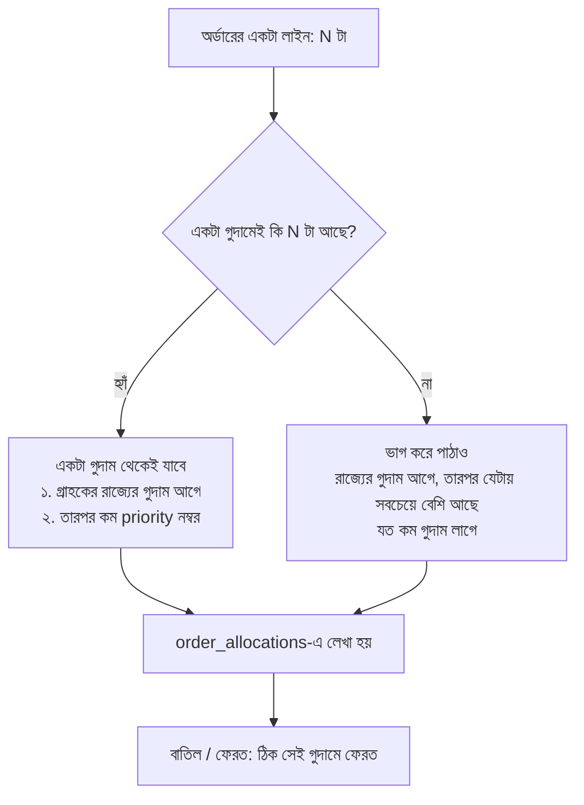

# Multi-warehouse inventory: একাধিক গুদাম

আগে দোকানে একটাই "স্টক" সংখ্যা ছিল। এখন মাল থাকে **গুদামে** (seed অনুযায়ী Pittsburgh `PIT`, Philadelphia `PHL`, Newark `NWK`)। প্রতিটা অর্ডার ঠিক করে কোন গুদাম থেকে মাল যাবে, আর বাতিল বা ফেরত হলে মাল **ঠিক সেই গুদামেই** ফেরে।

## মূল নিয়ম: মোট = গুদামগুলোর যোগফল

`products.stock` এখনো **মোট** স্টক, তাই catalog, cart আর overselling-রোধী পুরোনো atomic `UPDATE` আগের মতোই কাজ করে। নতুন `warehouse_stock` টেবিল বলে মালগুলো কোথায় আছে।

> **Invariant:** প্রতিটা পণ্যের জন্য `products.stock = SUM(warehouse_stock.quantity)`।
> এটা যাচাই হয় integration টেস্টে, PostgreSQL DB টেস্টে (`OrderDatabaseTest#warehousesHoldExactlyTheTotal`), আর performance test-এর পরেও।

## অর্ডারের সময় কোন গুদাম? (`WarehouseAllocator`)

- বন্ধ (switched off) বা খালি গুদাম কখনো মাল পাঠায় না।
- **একটা পার্সেল দুটোর চেয়ে ভালো।** যেমন PA-র দুই গুদামে ২+২ আছে, Newark-এ একাই ৪টা আছে। তখন ৪টার অর্ডার পুরোটা Newark থেকে যাবে।

## একসাথে অনেক অর্ডার: overselling নেই, deadlock নেই

1. `UPDATE products SET stock = stock - n WHERE stock >= n` চলে। এতে পণ্যের row lock হয়, তাই একই পণ্যের অর্ডার একটা একটা করে এগোয়।
2. তারপর ওই পণ্যের গুদাম-row-গুলো `FOR UPDATE` দিয়ে lock হয়। **সব সময় আগে পণ্য, তারপর গুদাম।** একই ক্রমে lock নেওয়ায় deadlock হয় না। Admin-এর adjust বা transfer-ও এই একই ক্রম মানে।
3. প্রতিটা গুদাম থেকে `quantity = quantity - n WHERE quantity >= n` দিয়ে মাল কমে। Database-এ `CHECK (quantity >= 0)` দ্বিতীয় নিরাপত্তা।
4. টেস্ট: ১০ জন ক্রেতা একসাথে কেনে, অথচ মোট ৩টা মাল আছে (২টা PIT-এ, ১টা NWK-এ)। ঠিক যতগুলো বিক্রি হয়, ততগুলোই allocated হয়, আর গুদামের যোগফল = মোট।

## Admin: Warehouses পাতা (Catalog → Warehouses)

| কাজ | নিয়ম |
|---|---|
| গুদাম যোগ / edit | code ২-১০ অক্ষর বা সংখ্যা (একই code দুবার নয়), রাজ্য ২ অক্ষরে, priority ১-৯৯৯। প্রতিটা পরিবর্তন audit trail-এ যায়। |
| গুদাম বন্ধ | শুধু খালি হলে, আর শেষ চালু গুদাম কখনো বন্ধ হয় না |
| মাল এসেছে (RECEIVED) | শুধু যোগ (+) |
| নষ্ট (DAMAGED) | শুধু বাদ (−), যতটা আছে তার বেশি নয় |
| গণনা সংশোধন | + বা −, কিন্তু ০ নয় |
| স্টক সরানো (transfer) | দুটো আলাদা গুদাম, যতটা আছে তার বেশি নয়, গন্তব্য চালু থাকতে হবে। মোট বদলায় না। |
| পণ্যের form-এ stock বদলানো | পার্থক্যটা default গুদামে (PIT) যায় বা সেখান থেকে কমে। সেখানে যথেষ্ট না থাকলে 400: "Warehouses পাতায় ঠিক করুন"। |

প্রতিটা পরিবর্তন `stock_movements`-এ গুদামসহ লেখা হয়। Admin-এর **All orders** পাতায় "Ships from" চাপলে দেখা যায় কোন গুদাম কয়টা পাঠাচ্ছে। **Reports**-এ নতুন রিপোর্ট আছে: "Stock by warehouse" (প্রতি গুদামে কত একক আর তার মূল্য)।

## API

| Endpoint | কাজ |
|---|---|
| `GET/POST /api/admin/warehouses`, `PUT /api/admin/warehouses/{id}` | গুদামের তালিকা, যোগ, edit |
| `GET /api/admin/products/{id}/stock` | একটা পণ্য কোন গুদামে কতটা |
| `POST /api/admin/stock/adjust` | `{productId, warehouseId, delta, reason}` |
| `POST /api/admin/stock/transfer` | `{productId, fromWarehouseId, toWarehouseId, quantity}` |
| `GET /api/admin/orders/{id}/allocations` | কোন গুদাম থেকে কয়টা যাচ্ছে |

## টেস্ট (RTM: REQ-INV-01 থেকে REQ-INV-05)

| স্তর | ফাইল |
|---|---|
| Unit | `WarehouseAllocatorTest` (সিদ্ধান্তের নিয়ম), `InventoryServiceTest`, `WarehouseServiceTest`, `ProductServiceTest`, `ReportServiceTest` |
| Integration | `WarehouseIntegrationTest`, `OrderConcurrencyIntegrationTest` (দুই গুদামে একসাথে অনেক অর্ডার) |
| API | `WarehouseApiTest` |
| Database | `OrderDatabaseTest#warehousesHoldExactlyTheTotal` (PostgreSQL-এ সব পণ্যের invariant) |
| UI | `playwright/tests/admin-suite.spec.ts`, `AccessibilityTest` (এখন ২৩টা পাতা) |

## ইন্টারভিউয়ে কীভাবে বলবেন

*"I extended inventory to several warehouses without touching the overselling guard: the product total stays the single atomic check, and warehouse rows are locked after it in one fixed order, so there are no deadlocks. Orders ship from one warehouse when possible, from the customer's state first, otherwise split over the fewest warehouses; cancels and returns go back exactly where the units came from. A database test proves that the total always equals the sum over the warehouses."*

এটা আপনার warehouse আর packaging-এর অভিজ্ঞতার সাথে মেলে: **FIFO বা location-ভিত্তিক picking, stock transfer, damage write-off, আর cycle count correction**।
