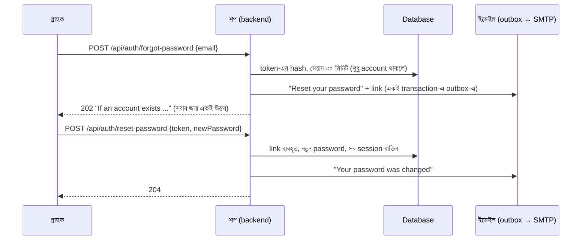

# Password ভুলে গেলে: ইমেইলে reset link

Login পাতায় এখন **"Forgot your password?"** আছে। গ্রাহক তার ইমেইল দেন, একটা link পান, link খুলে নতুন password বেছে নেন। ছোট একটা feature, কিন্তু security-র দিক থেকে ভুল করার জায়গা অনেক। তাই প্রতিটা ঝুঁকির জন্য আলাদা নিয়ম আর আলাদা টেস্ট রাখা হয়েছে।

## কীভাবে কাজ করে

## নিয়ম আর কেন

| নিয়ম | কেন |
|---|---|
| অজানা ইমেইলেও **একই 202, একই বাক্য** | উত্তর দেখে কেউ যেন জানতে না পারে কোন ইমেইলে account আছে (account enumeration) |
| Token = ২৫৬ bit random, database-এ শুধু **SHA-256 hash** | Database-এর কপি চুরি হলেও link বানানো যায় না |
| Link **একবার**, **৩০ মিনিট** | পুরনো ইমেইল বা forward করা link দিয়ে পরে আর ঢোকা যায় না |
| নতুন link চাইলে পুরনো link অচল | শুধু সবচেয়ে নতুন ইমেইলটাই কাজ করে |
| একই মুহূর্তে দুই request: database-এর `used_at is null` শর্তে একটাই জেতে | Race condition-এ link দুবার ব্যবহার হয় না |
| ঘণ্টায় সর্বোচ্চ **৩টা** link, তার বেশি নীরবে বাদ | কারো inbox ভরিয়ে দেওয়া (mail bombing) ঠেকাতে। উত্তর তবু একই, যাতে সীমা থেকেও কিছু বোঝা না যায় |
| Reset-এর পর **সব device logout** (refresh token বাতিল) | চোর আগে থেকে ঢুকে থাকলে সেও বেরিয়ে যায় |
| Login lockout উঠে যায় | ভুল password দিয়ে lock হওয়া গ্রাহক reset করে সাথে সাথে ঢুকতে পারেন |
| **"Your password was changed"** ইমেইল | গ্রাহক নিজে না করে থাকলে সাথে সাথে জানতে পারেন |
| পাঠানোর পর ইমেইলের body থেকে link মুছে ফেলা হয় | Outbox টেবিলে কাজ-করা link পড়ে থাকে না |
| নতুন password-এর নিয়ম registration-এর মতোই (৮–৭২) | এক নিয়ম, সব জায়গায় |

**যা জেনেশুনে রাখা হয়েছে:**
- Access token (JWT) তার ১৫ মিনিট মেয়াদ পর্যন্ত চলে, logout-এর মতোই। এই কারণেই এর মেয়াদ ছোট রাখা।
- অজানা ইমেইলে database-এ লেখা হয় না, তাই উত্তর কয়েক millisecond দ্রুত আসে। Login-এর মতো সময় পুরো সমান করতে হলে request-টা queue-তে পাঠিয়ে সাথে সাথে উত্তর দিতে হয়। Portfolio-তে এটা "পরের ধাপ" হিসেবে লেখা থাকল।
- Public demo-তে ইমেইল যায় সার্ভারের ভেতরের Mailpit-এ, ভিজিটর সেটা দেখতে পান না। তাই demo-তে reset-এর পুরো পথ দেখানো যায় না, শুধু "Forgot password" পাতা দেখা যায়।

## Link-এর ঠিকানা
ইমেইলের link হয় `PUBLIC_URL` + `/#/reset-password?token=...`। নিজের Mac-এ `http://localhost:5173`, demo-তে `https://<DEMO_DOMAIN>` (`deploy/docker-compose.yml` নিজেই বসায়)।

## টেস্ট (RTM: REQ-AUTH-12 থেকে REQ-AUTH-14)

| স্তর | টেস্ট |
|---|---|
| Unit | `PasswordResetServiceTest` (১৪টা): অজানা ইমেইল, hash, মেয়াদের শেষ সেকেন্ড, ব্যবহৃত বা মেয়াদোত্তীর্ণ link, race, ঘণ্টার সীমা, মুছে-ফেলা account। `NotificationDeliveryServiceTest`: পাঠানোর পর link মোছা, ব্যর্থ হলে মোছা হয় না |
| Integration | `PasswordResetIntegrationTest` (৮টা): পুরো পথ H2 database আর outbox দিয়ে, lockout ওঠা, পুরনো session 401 |
| API | `PasswordResetApiTest`: আসল ইমেইল **Mailpit** থেকে পড়ে link বের করা, একই উত্তর, ঘণ্টার সীমা |
| UI (Selenium) | `UiPasswordResetTest`: login পাতা → ইমেইল → link → নতুন password → login। দুটো password না মিললে, বা ব্যবহৃত link-এ শপের বার্তা |
| Playwright | `password.spec.ts`: দুজনের জন্য পাতা আর API দুটোই একই উত্তর দেয়। Token ছাড়া পাতা খুললে কী দেখায় |
| Accessibility | "Forgot password" আর "New password" পাতা WCAG 2.1 AA (মোট ১৭ পাতা) |

## Interview-এ বলার মতো
> "Password reset ছোট feature, কিন্তু security-র দিক থেকে কঠিন। আমি পাঁচটা ঝুঁকি আলাদা করে টেস্ট করেছি: account enumeration, token চুরি (শুধু hash রাখা), replay (একবার, ৩০ মিনিট, race-safe), mail bombing (ঘণ্টায় ৩টা) আর reset-এর পর চোরের session। API টেস্ট আসল ইমেইল Mailpit থেকে পড়ে link বের করে, তাই পুরো পথটাই প্রমাণিত।"
