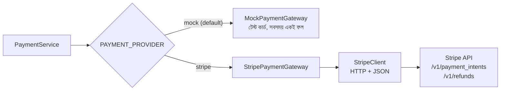
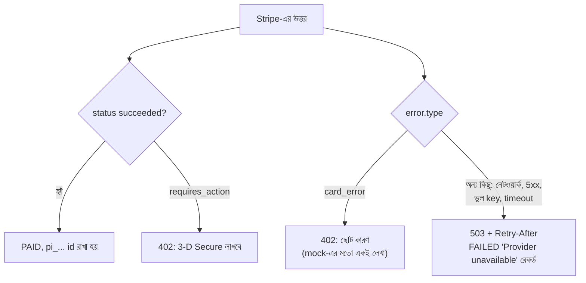
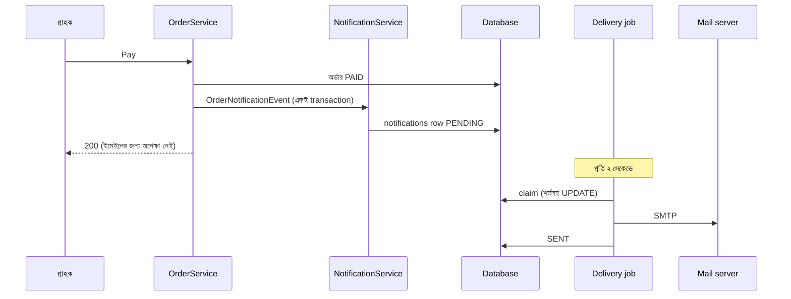
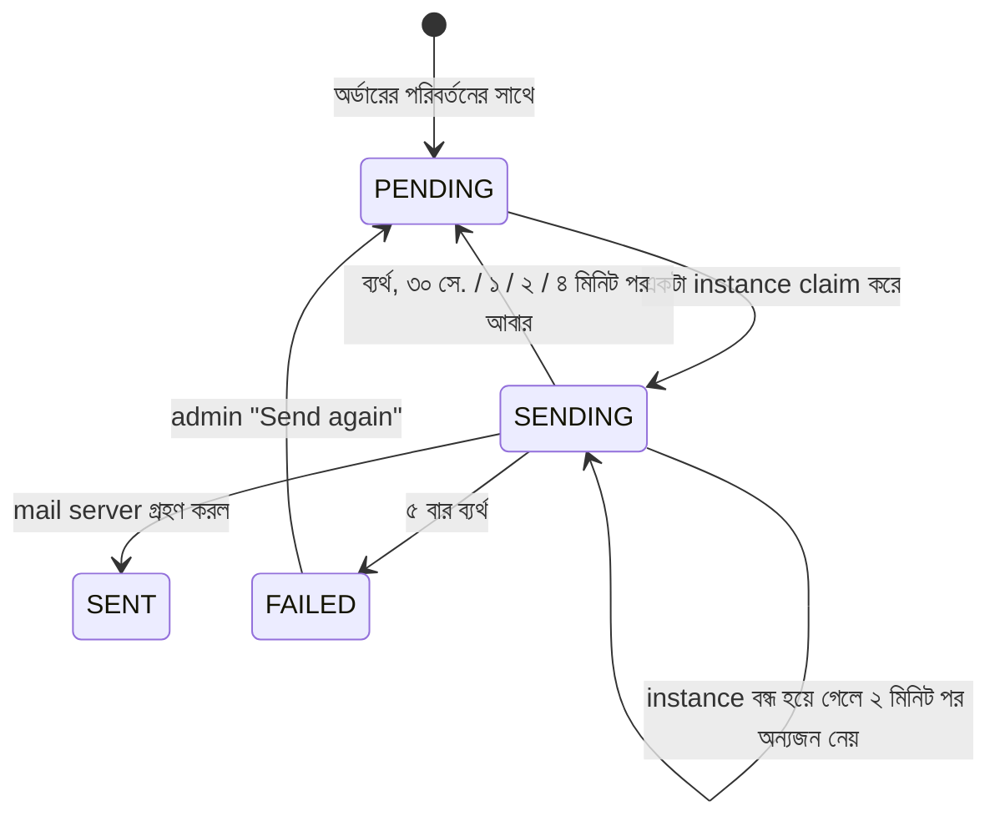

# Stripe পেমেন্ট আর অর্ডারের ইমেইল

এই ধাপে দুটো জিনিস যোগ হয়েছে:

1. **Stripe পেমেন্ট:** আসল payment provider-এর সাথে কাজ করার কোড, আর তার তিন স্তরের টেস্ট।
2. **অর্ডারের ইমেইল:** অর্ডারের প্রতিটা ধাপে গ্রাহক ইমেইল পান। পাঠানো হয় "transactional outbox" দিয়ে, যাতে ইমেইল কখনো ভুল সময়ে না যায় আর হারিয়েও না যায়।

## ১. Stripe পেমেন্ট

### কোন provider চলবে



- **Default `mock`।** সব পুরোনো টেস্ট আগের মতোই নির্দিষ্ট ফল পায়।
- `PAYMENT_PROVIDER=stripe` আর `STRIPE_SECRET_KEY=sk_test_...` দিলে আসল Stripe-এর test mode চলে।
- **নিরাপত্তার নিয়ম:** live key (`sk_live_`) `prod` profile ছাড়া দিলে backend চালুই হয় না, যাতে টেস্টের সময় কখনো আসল টাকা না কাটে। key ছাড়া বা ভুল নামেও চালু হয় না।
- **কার্ড নম্বর Stripe-এ যায় না।**
  - আসল দোকানে browser-ই কার্ড সরাসরি Stripe-কে দেয় (Stripe Elements), backend শুধু একটা PaymentMethod id পায়।
  - এই demo-তে নিজের কার্ড ফর্ম আছে, তাই backend Stripe-এর টেস্ট কার্ডগুলোকে Stripe-এর তৈরি টেস্ট PaymentMethod-এ বদলে নেয়:

| কার্ড | Stripe PaymentMethod | ফল |
|---|---|---|
| 4242 4242 4242 4242 | `pm_card_visa` | পাস |
| 5555 5555 5555 4444 | `pm_card_mastercard` | পাস |
| 4000 0000 0000 0002 | `pm_card_chargeDeclined` | "Card declined" (402) |
| 4000 0000 0000 9995 | `pm_card_chargeDeclinedInsufficientFunds` | "Insufficient funds" (402) |
| 4000 0000 0000 0069 | `pm_card_chargeDeclinedExpiredCard` | "Card has expired" (402) |
| 4000 0000 0000 0127 | `pm_card_chargeDeclinedIncorrectCvc` | "Incorrect CVC" (402) |

### নকশার সিদ্ধান্ত

- **টাকা cents-এ যায়।** $24.50 → `2450`। Stripe দশমিক নেয় না; contract টেস্টেই এটা ধরা পড়ে।
- **Idempotency key, যাতে দুবার টাকা না কাটে:**
  - charge-এর key: `order-{id}-charge-{cents}-{কার্ড}`।
  - নেটওয়ার্ক বিচ্ছিন্ন হওয়ার পর গ্রাহক আবার "Pay" চাপলে Stripe প্রথম ফলটাই ফেরত দেয়।
  - refund-এর key-তে refund-এর ক্রমিক নম্বর থাকে। ফলে retry দুবার টাকা ফেরত দেয় না, কিন্তু দ্বিতীয় আসল refund ঠিকই যায়।
- **কার্ডের সমস্যা বনাম Stripe-এর সমস্যা:**



- **Stripe-এর id (`pi_...`, `re_...`) database-এ থাকে** (V9 migration), refund আর support-এর জন্য। API-তে দেখানো হয় না, তাই API contract বদলায়নি।
- **Stripe SDK ছাড়া, সাধারণ `java.net.http` দিয়ে।** অনুরোধ তৈরি আর উত্তর পড়ার কোড আমাদের নিজেদের, আর ঠিক সেটাই টেস্ট হয়।

### টেস্টের তিন স্তর (Stripe নিজেই যেভাবে করতে বলে)

| স্তর | টেস্ট | কী প্রমাণ করে | কখন চলে |
|---|---|---|---|
| ১. Consumer contract | `StripeContractIntegrationTest` | আমাদের অনুরোধ আসল Stripe API-র নিয়ম মানে। **stripe-mock** Stripe-এর OpenAPI spec থেকে তৈরি; ভুল নাম, ভুল ধরন বা dollar amount হলে 400 দেয় | প্রতিটা build (Docker, Testcontainers, `stripe/stripe-mock:v0.206.0` pin করা) |
| ২. রেকর্ড করা উত্তর | `StripeClientTest` | decline, টাকা নেই, মেয়াদ শেষ, 3-D Secure, 500, HTML error page, timeout, সংযোগ নেই: সব উত্তর ঠিকমতো পড়া হয় | প্রতিটা build (local HTTP server) |
| ৩. আসল Stripe test mode | `StripeSandboxIntegrationTest` | আসল আচরণ: পাস, decline, আংশিক refund, retry-তে দ্বিতীয়বার charge হয় না | শুধু `STRIPE_TEST_SECRET_KEY` থাকলে; নইলে নিজে skip |

- **stripe-mock-এর সীমা:** এটা আচরণ নকল করে না। সবসময় একই status দেয় (`requires_payment_method`), decline দিতে পারে না। তাই শুধু stripe-mock দিয়ে পরীক্ষা অসম্পূর্ণ, এজন্যই উপরের তিন স্তর।
- **contract টেস্ট আসলে কিছু পরীক্ষা করে কিনা, সেটাও যাচাই:** তিনটা টেস্ট দেখায় stripe-mock সত্যিই ভুল অনুরোধ ফিরিয়ে দেয় (dollar amount, অজানা parameter, key ছাড়া)। এটা না থাকলে সফল contract টেস্টের কোনো মানে থাকত না।
- **Stripe test key যোগ করতে:**
  1. stripe.com-এ বিনা খরচে account খুলুন।
  2. Developers → API keys থেকে `sk_test_...` কপি করুন।
  3. GitHub repo → Settings → Secrets and variables → Actions → New repository secret: নাম `STRIPE_TEST_SECRET_KEY`।
  - এরপর থেকে CI প্রতিবার আসল Stripe test mode-এও চলবে। কোনো টাকা কাটে না।

## ২. অর্ডারের ইমেইল (transactional outbox)

### কেন সরাসরি না পাঠিয়ে outbox

| সরাসরি পাঠালে | সমস্যা |
|---|---|
| অর্ডার save-এর আগে পাঠালে | পরে rollback হলে গ্রাহক এমন অর্ডারের ইমেইল পান যা নেই |
| save-এর পরে পাঠালে | ঠিক সেই মুহূর্তে server বন্ধ হলে ইমেইল হারিয়ে যায় |
| checkout-এর ভেতরেই পাঠালে | mail server ধীর হলে checkout-ও ধীর |

**সমাধান:** ইমেইলটা আগে `notifications` টেবিলে একটা row হয়ে লেখা হয়, অর্ডারের পরিবর্তনের **একই transaction-এ**। পাঠানোর কাজ পরে আলাদাভাবে হয়।



### ইমেইলের অবস্থা



- **দুই backend একই row পাঠায় না।** Claim হয় শর্তসহ `UPDATE`-এ, একজনই জেতে।
  - CI-তে দুটো backend একই outbox ব্যবহার করে, আর টেস্ট নিশ্চিত করে প্রতিটা ঘটনার ইমেইল **ঠিক একটাই** গেছে।
- **At-least-once:**
  - Mail server ইমেইল নেওয়ার পর কিন্তু "SENT" লেখার আগে instance বন্ধ হলে, ২ মিনিট পর ইমেইলটা আবার যায়।
  - একটা নিশ্চিতকরণ ইমেইল হারানোর চেয়ে কালেভদ্রে একটা ডুপ্লিকেট ভালো।
- **কোন কোন ঘটনায় ইমেইল যায়:**
  - অর্ডার দেওয়া (পণ্য, ছাড়, শিপিং, কর, মোট)
  - পেমেন্ট
  - শিপ (carrier আর tracking number)
  - ডেলিভারি (৩০ দিনের রিটার্নের কথা)
  - বাতিল (refund থাকলে তার পরিমাণ)
  - রিটার্ন অনুমোদন (refund) বা প্রত্যাখ্যান
- **ইমেইল plain text, ইংরেজিতে।** গ্রাহকের ভাষা এখন শুধু browser-এ থাকে, server জানে না। একাধিক ভাষার ইমেইল পরের ধাপ।
- **Admin প্যানেল → "E-mails":**
  - কাকে কোন ইমেইল গেছে, অবস্থা আর ভুলের কারণ দেখা যায়।
  - FAILED ইমেইলে **Send again** বোতাম থাকে।
  - পাতাটা ৬ ভাষায় আছে, আর axe দিয়ে desktop, mobile, বাংলা আর আরবিতে পরীক্ষা করা।
- **চ্যানেল:**
  - `NOTIFICATIONS_CHANNEL=log` (default): ইমেইল শুধু log-এ লেখা হয়।
  - `NOTIFICATIONS_CHANNEL=smtp`: সত্যি পাঠানো হয়। Docker Compose আর CI-তে Mailpit-এ যায়।

### Mailpit: ইমেইল দেখা

```bash
docker compose --profile app up -d --build --wait
# অর্ডার দিন, তারপর browser-এ:
open http://localhost:8025        # Windows: start http://localhost:8025
```

Mailpit সব ইমেইল ধরে রাখে, বাইরে কিছু যায় না। Web inbox-এ বিষয়, প্রাপক আর লেখা দেখা যায়।

## ৩. টেস্ট

| স্তর | টেস্ট | কী প্রমাণ করে |
|---|---|---|
| Unit | `NotificationServiceTest` | প্রতিটা ইমেইলের বিষয় আর লেখা, টাকা সবসময় ২ দশমিকে, মুছে ফেলা account-এ ইমেইল নেই, admin তালিকা আর "Send again" |
| Unit | `NotificationDeliveryServiceTest` | claim, অন্য instance নিয়ে নিলে পাঠায় না, retry-র সময় (৩০ সে. থেকে ৪ মিনিট), ৫ম বারে FAILED, একটা খারাপ ঠিকানা বাকিদের আটকায় না |
| Unit | `OrderServiceTest`, `FulfillmentServiceTest`, `ReturnServiceTest` | ঠিক ঘটনাটা publish হয়; পরিবর্তন প্রত্যাখ্যাত হলে কিছুই publish হয় না |
| Integration (H2) | `NotificationIntegrationTest` | HTTP থেকে database: declined কার্ডে পেমেন্টের ইমেইল নেই, 409 হলে rollback তাই ইমেইলও নেই, delivery job SENT করে, admin API |
| Integration (আসল SMTP) | `MailpitSmtpIntegrationTest` | Testcontainers-এ Mailpit: প্রেরক, প্রাপক, বিষয়, UTF-8 লেখা (বাংলা, চীনা); mail server না থাকলে error, যাতে retry হয় |
| API end-to-end | `NotificationEmailTest` | আসল inbox: প্রতিটা ঘটনার ইমেইল ঠিক একটাই, মোট টাকা, API-র সাথে একই tracking number, SENT অবস্থা, declined হলে ইমেইল নেই |
| Accessibility | `AccessibilityTest` | "E-mails" পাতা যোগ হয়ে এখন ১৪টা পাতা |

**টেস্টের সূক্ষ্ম বিষয়:**
- Mail server ইমেইলটা নেয় backend "SENT" লেখার একটু **আগে**। তাই টেস্ট একবার পড়ে না, SENT হওয়া পর্যন্ত অপেক্ষা করে।
- Inbox-এর জন্যও নির্দিষ্ট সময় ঘুমিয়ে থাকে না, polling করে (সর্বোচ্চ ২০ সেকেন্ড)।

## ৪. কনফিগারেশন

| Variable | Default | মানে |
|---|---|---|
| `PAYMENT_PROVIDER` | mock | `mock` বা `stripe` |
| `STRIPE_SECRET_KEY` | (খালি) | `sk_test_...`; live key শুধু `prod` profile-এ |
| `STRIPE_API_BASE` | https://api.stripe.com | stripe-mock: `http://localhost:12111` |
| `NOTIFICATIONS_CHANNEL` | log | `log` বা `smtp` |
| `MAIL_HOST`, `MAIL_PORT` | localhost, 1025 | Mailpit |
| `NOTIFICATIONS_POLL_MS` | 2000 | outbox কতক্ষণ পরপর দেখা হয় |

## ৫. জেনেশুনে মেনে নেওয়া সীমা

- **SMTP-তে এখন username/password বা TLS নেই।** Mailpit-এর জন্য যথেষ্ট। আসল ইমেইল সেবায় (SES, SendGrid, Gmail) port 587, STARTTLS আর credentials লাগবে, সেটা পরের কাজ।
- **ইমেইল শুধু ইংরেজিতে।**
- **কার্ডের ফর্ম আমাদের নিজের।** আসল দোকানে Stripe Elements দিয়ে browser থেকেই কার্ড Stripe-এ যাওয়া উচিত (PCI scope কমে)।
- **Stripe webhook নেই।** পরে কোনো dispute বা refund-এর অবস্থা বদলালে আমাদের database জানে না।

## ৬. Interview-এ

> "Stripe integration তিন স্তরে টেস্ট করি, Stripe নিজেই যেমন বলে। stripe-mock দিয়ে consumer contract, যেটা Stripe-এর OpenAPI spec থেকে প্রতিটা অনুরোধ যাচাই করে। Decline আর outage-এর জন্য রেকর্ড করা উত্তর। আর key থাকলে আসল test mode। Contract টেস্টের পাশে নিজেরই একটা পরীক্ষা রেখেছি, যা দেখায় mock সত্যিই ভুল অনুরোধ ফিরিয়ে দেয়। Idempotency key দিয়ে timeout-এর পর retry-তে দ্বিতীয়বার charge হয় না। ইমেইল transactional outbox দিয়ে: rollback হলে ইমেইল নেই, mail server বন্ধ থাকলে retry, আর দুই backend কখনো একই ইমেইল দুবার পাঠায় না। এটা CI-তে আসল Mailpit inbox পড়ে প্রমাণ করি।"
