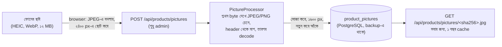

# পণ্যের ছবি আপলোড (আসল দোকানের জন্য)

আগে পণ্যের ছবি ছিল দুই রকম: frontend-এর ভেতরে রাখা ফাইল (`/products/<নাম>.svg`) অথবা অন্য কোনো সাইটের `https://` লিংক।
আসল দোকানে এর কোনোটাই চলে না। প্রতিটা নতুন পণ্যের জন্য frontend আবার build করা যায় না, আর অন্যের সাইটের লিংক যেকোনো দিন ভেঙে যেতে পারে।
এখন মালিক ফোনে ছবি তুলে সরাসরি admin পাতা থেকে আপলোড করতে পারেন।
কেন এই সিদ্ধান্ত: [ADR-0017](../adr/0017-product-photo-uploads.md)।

## কীভাবে ব্যবহার করবেন

1. Admin → **Products** → নতুন পণ্য (**Add product**) অথবা পুরোনো পণ্যের **Edit**।
2. **Upload a photo**-তে ছবি বাছুন। ফোনে এটা ক্যামেরা বা গ্যালারি খোলে।
3. "Photo uploaded" দেখালে Picture ঘরে `/api/products/pictures/<লম্বা নাম>.jpg` বসে যায়, আর পাশে preview দেখায়।
4. **Save** বা **Update** দিন। এখন ছবিটা দোকানের তালিকা আর পণ্যের পাতায় দেখাবে।

- চলে: JPEG, PNG, WebP, ১০ MB পর্যন্ত। iPhone-এর HEIC ছবি Safari-তে চলে। অন্য browser HEIC পড়তে না পারলে বার্তা দেখায়।
- ছোট দিকটা অন্তত ২০০ pixel হতে হবে।
- আপলোড করে Save না দিলে ছবিটা কোনো পণ্যে বসে না। ছবিটা অবশ্য server-এ থেকে যায়, একই ছবি আবার দিলে নতুন কপি হয় না।

## ছবির সাথে কী হয়



| ধাপ | কেন |
|---|---|
| ফাইলের প্রথম কয়েক byte দেখে চেনা, নাম বা browser-এর বলা type নয় | `photo.jpg` নামে একটা script ঢুকতে পারে না |
| SVG কখনো নয় | SVG-র ভেতরে JavaScript থাকতে পারে |
| decode-এর আগে header থেকে মাপ পড়া: সর্বোচ্চ ৫০ megapixel | কয়েক KB-র একটা "decompression bomb" খুললে কয়েক GB memory খেয়ে server বসিয়ে দিত |
| EXIF orientation অনুযায়ী সোজা করা | ফোন পাশ ফিরিয়ে ধরলে ছবি শুয়ে থাকত |
| ১৬০০ px-এ ছোট করা | দোকানের পাতা দ্রুত খোলে, database ছোট থাকে |
| নতুন করে JPEG (বা স্বচ্ছ হলে PNG) বানানো | EXIF-এ থাকা GPS লোকেশন (মালিকের বাসার ঠিকানা!), comment, ছবির পরে লুকানো কিছু, সব মুছে যায় |
| নাম = নতুন ফাইলের SHA-256 | একই ছবি দুবার রাখা হয় না, আর ঠিকানাটা কখনো অন্য ছবি দেখায় না, তাই browser এক বছর মনে রাখতে পারে |
| একসাথে সর্বোচ্চ ২টা ছবি প্রক্রিয়া | বড় ছবি decode করতে অনেক memory লাগে; তৃতীয়টা 429 পেয়ে একটু পরে আবার চেষ্টা করে |

## কোথায় থাকে, backup

ছবি থাকে database-এর `product_pictures` টেবিলে (migration V27)। তাই আলাদা কিছু করতে হয় না:

- প্রতিদিনের encrypted backup আর S3 bucket-এর কপিতে ছবিও থাকে ([PRODUCTION_BN](../deploy/PRODUCTION_BN.md))।
- restore মহড়া `product_pictures`-এর সারি গুনে মেলায়।
- CI-র "Production stack" gate প্রতিবার প্রমাণ করে: Caddy আর nginx পার হয়ে ৪ MB-র একটা ছবি আপলোড হয়, backup-এ যায়, আর restore-এর পরে ছবিটা আবার পাওয়া যায়।

## সীমা

| কোথায় | সীমা |
|---|---|
| শুধু `/api/products/pictures` (Caddy, nginx) | ১১ MB (১০ MB ছবি + multipart-এর মোড়ক) |
| বাকি সব request | আগের মতোই ১ MB |
| Spring | ছবি ১০ MB, পুরো request ১১ MB; বেশি হলে 413 "The picture is larger than 10 MB" |

## API

```bash
# admin token দিয়ে আপলোড
curl -X POST https://<domain>/api/products/pictures -H "Authorization: Bearer $TOKEN" -F "file=@mug.jpg"
# 201 {"url":"/api/products/pictures/3f2a...e1.jpg","width":1600,"height":1200,"contentType":"image/jpeg","sizeBytes":245113}
# একই ছবি আবার: 200, একই url

# তারপর পণ্যের ছবি হিসেবে বসানো (PUT পুরো পণ্য বদলায়)
curl -X PUT https://<domain>/api/products/42 -H "Authorization: Bearer $TOKEN" -H 'Content-Type: application/json' \
  -d '{"name":"Mug","sku":"HOME-MUG-002","price":12.5,"stock":10,"imageUrl":"/api/products/pictures/3f2a...e1.jpg"}'
```

| উত্তর | মানে |
|---|---|
| 400 | JPEG/PNG নয়, পড়া যায় না (যেমন CMYK JPEG), ২০০ px-এর কম, ৫০ megapixel-এর বেশি, বা পাবলিক ডেমো |
| 401 / 403 | লগইন নেই / admin নন |
| 413 | ১০ MB-র বেশি |
| 429 | আরো দুটো ছবি এই মুহূর্তে প্রক্রিয়া হচ্ছে |

## পাবলিক ডেমোতে

ডেমোতে যে কেউ admin হতে পারে, তাই সেখানে আপলোড বন্ধ (backend 400 দেয়, আর ডেমো build-এ বোতামের বদলে একটা নোট দেখায়)।
এটা বাইরের লিংক বন্ধ রাখার একই কারণ ([ADR-0009](../adr/0009-public-demo-on-one-server.md))।

## টেস্ট (REQ-CAT-15)

| স্তর | টেস্ট | কী প্রমাণ করে |
|---|---|---|
| Unit | `PictureProcessorTest` | মাপ, ৮ রকম EXIF orientation, EXIF মুছে যাওয়া, SVG/GIF/WebP/ভাঙা ফাইল/bomb ফেরত |
| Unit | `ProductPictureServiceTest` | ডেমো, একসাথে ২টা, কে কখন আপলোড করলেন, ভুল নামে 404 |
| Integration | `ProductPictureIntegrationTest` | আসল API আর database: 201/200, cache header, 304, পণ্যে বসানো, 401/403, ভুল ফাইলে 400 |
| UI | `playwright/tests/product-photos.spec.ts` | admin form থেকে আপলোড, দোকানের পাতায় ছবি, WebP থেকে JPEG, ভুল ফাইলে বার্তা |
| Production | CI "Production stack" | Caddy + nginx দিয়ে ৪ MB, backup আর restore-এর পরেও ছবি |

**Interview-এ:** "File upload-কে আমি untrusted input হিসেবে ধরেছি: byte দেখে type চেনা, decode-এর আগে মাপ যাচাই, আর আপলোডের কিছুই না রেখে শুধু pixel থেকে নতুন ফাইল বানানো। এতে script, decompression bomb আর ফোনের GPS লোকেশন একসাথে আটকায়। ছবি database-এ রাখায় backup আর restore-এর আগের প্রমাণ ছবির জন্যও খাটে।"
