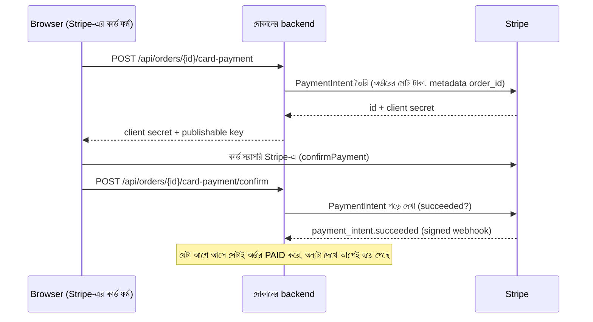

# Stripe Elements আর webhook (দোকানের Phase 2)

এই ধাপের লক্ষ্য একটাই: **আসল দোকান কখনো কার্ড নম্বর দেখবে না, আর অর্ডার PAID হবে শুধু Stripe "হ্যাঁ" বললে।**
সিদ্ধান্তের কারণ আর দাম: [ADR-0011](../adr/0011-stripe-elements-and-webhooks.md)।

## পেমেন্ট কীভাবে হয়



- **ব্রাউজারের কথা বিশ্বাস করা হয় না।** status আর টাকার পরিমাণ backend নিজে Stripe থেকে পড়ে।
- **একবারই পেমেন্ট:** `payment_intents.settled_at` একটা atomic UPDATE দিয়ে দখল হয়। confirm আর webhook একসাথে এলেও অর্ডার দুবার PAID হয় না।
- **একই event দুবার নয়:** Stripe 2xx না পাওয়া পর্যন্ত event আবার পাঠায়। `stripe_events` টেবিলে প্রতিটা event id একবারই কাজ করে।
- **ভুল টাকা কখনো PAID নয়:** Stripe-এর টাকা অর্ডারের মোটের সাথে না মিললে FAILED পেমেন্ট লেখা হয় ("Paid amount does not match the order")।
- **webhook-এর সই:** `Stripe-Signature` header-এর HMAC-SHA256 মেলাতে হবে, আর ৫ মিনিটের বেশি পুরোনো হলে বাতিল (replay আটকাতে)। secret না থাকলে 503, কখনো "সব মেনে নাও" নয়।
- **live key কার্ড নম্বর নেয় না:** `sk_live_` হলে পুরোনো `/pay` আর wallet-এ কার্ড সেভ "Enter the card in the secure card form" বলে থামে।

## কী সেট করতে হয়

| Variable | কোথা থেকে | কাজ |
|---|---|---|
| `PAYMENT_PROVIDER` | `stripe` | Stripe চালু |
| `STRIPE_SECRET_KEY` | Stripe Dashboard → Developers → API keys (`sk_test_...`) | backend-এর key, কখনো browser-এ যায় না |
| `STRIPE_PUBLISHABLE_KEY` | একই পাতা (`pk_test_...`) | এটা থাকলেই Stripe-এর কার্ড ফর্ম দেখায় |
| `STRIPE_WEBHOOK_SECRET` | `stripe listen` বা Dashboard → Webhooks (`whsec_...`) | webhook-এর সই মেলাতে |

- secret key আর publishable key একই mode-এর হতে হবে (দুটোই test বা দুটোই live), নইলে backend চালু হয় না।
- কোনো key না দিলে আগের মতো mock provider আর দোকানের নিজের কার্ড ফর্ম চলে। সব পুরোনো টেস্ট আর demo বদলায় না।

## নিজের কম্পিউটারে test mode-এ চালানো

```bash
# ১. .env-এ test key বসান
PAYMENT_PROVIDER=stripe
STRIPE_SECRET_KEY=sk_test_...
STRIPE_PUBLISHABLE_KEY=pk_test_...

# ২. Stripe CLI দিয়ে webhook নিজের মেশিনে আনুন (এটা whsec_... দেখায়, সেটা .env-এ বসান)
stripe login
stripe listen --forward-to localhost:8081/api/payments/stripe/webhook
STRIPE_WEBHOOK_SECRET=whsec_...

# ৩. চালু করুন
docker compose up --build
```

তারপর একটা অর্ডার দিয়ে অর্ডারের পাতায় Stripe-এর ফর্মে টেস্ট কার্ড দিন:

| কার্ড | ফল |
|---|---|
| 4242 4242 4242 4242 | পাস, অর্ডার PAID |
| 4000 0000 0000 9995 | "Your card has insufficient funds", অর্ডার PLACED থাকে |
| 4000 0025 0000 3155 | 3-D Secure পরীক্ষার পর্দা, তারপর পাস |

মেয়াদ যেকোনো ভবিষ্যৎ তারিখ, CVC যেকোনো ৩ অঙ্ক। `stripe listen`-এর জানালায় `payment_intent.succeeded  [200]` দেখা উচিত।

## টেস্ট কোথায়

| স্তর | টেস্ট | কী প্রমাণ করে |
|---|---|---|
| Unit | `StripeWebhookTest` | সই (Python দিয়ে বের করা known answer), ৫ মিনিটের সীমা, ভাঙা header, event পড়া |
| Unit | `StripePaymentGatewayTest`, `StripeClientTest`, `PaymentGatewayConfigTest` | PaymentIntent তৈরি, idempotency key, key-এর mode মেলানো, live key কার্ড নম্বর নেয় না |
| Integration | `StripeElementsIntegrationTest` | confirm আর webhook-এর দৌড়ে একবারই PAID, ভুল টাকা, অন্য intent, একই event দুবার, অন্যের অর্ডার |
| Integration | `CardPaymentMockProviderIntegrationTest` | key ছাড়া দোকানের নিজের ফর্ম, webhook secret ছাড়া 503 |
| Contract | `StripeContractIntegrationTest` | Stripe-এর রেকর্ড করা উত্তর থেকে ঠিক জিনিস পড়া |
| Browser | `playwright/tests/stripe-elements.spec.ts` | কার্ডের ঘর Stripe-এর frame-এ, দোকানে কোনো কার্ড নম্বর যায় না, decline-এর কারণ দেখায় |
| Security | `AccessControlMatrixTest` | নতুন তিনটা endpoint-এর অনুমতি |

Requirement: REQ-PAY-09 আর REQ-PAY-10 ([traceability](../qa/TRACEABILITY_MATRIX.md))।

**Interview-এ:** "Card data কখনো আমাদের server-এ আসে না, তাই PCI scope SAQ A। Order PAID হয় শুধু Stripe-এর signed webhook বা Stripe থেকে পড়া status-এ; confirm আর webhook-এর race একটা atomic UPDATE দিয়ে মেটানো, তাই double payment অসম্ভব।"
