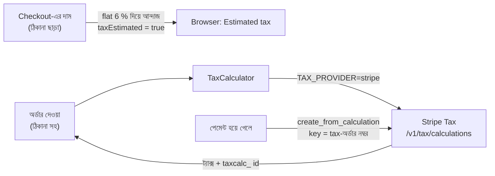

# Stripe Tax: ঠিকানা অনুযায়ী সঠিক sales tax (দোকানের Phase 3, প্রথম অংশ)

আগে প্রতিটা অর্ডারে একই 6 % ট্যাক্স বসত। আসল দোকানে ট্যাক্স নির্ভর করে জিনিস কোথায় যাচ্ছে তার উপর:
state, county, city সবার আলাদা হার। এই ধাপে সেই হিসাব Stripe Tax-কে দেওয়া হয়েছে।
কেন এই সিদ্ধান্ত: [ADR-0012](../adr/0012-stripe-tax.md)।

## কীভাবে কাজ করে



- **Default `flat`।** আগের মতোই 6 %, সব পুরোনো টেস্ট আর সংখ্যা একই থাকে।
- **`TAX_PROVIDER=stripe`** দিলে Stripe Tax চালু হয়। পেমেন্টের `STRIPE_SECRET_KEY`-ই ব্যবহার হয়, আলাদা account লাগে না।
- **Stripe কী পায়:** প্রতিটা line (SKU, সংখ্যা, discount বাদ দিয়ে দাম), shipping-এর খরচ, আর ডেলিভারির ঠিকানা।
  coupon-এর discount line-গুলোর দামের অনুপাতে ভাগ হয়, পয়সার বাকিটা শেষ line পায়, তাই যোগফল একদম মেলে।
- **অনুমানের ট্যাক্সে কখনো অর্ডার নয়:**
  - ঠিকানা ছাড়া checkout-এর দাম শুধু আন্দাজ, পাতায় লেখা থাকে "Estimated tax"।
  - Stripe ঠিকানা চিনতে না পারলে 400 ("check the address"), Stripe না পেলে 503। দুটোতেই কিছু সেভ হয় না, stock আটকায় না, cart খালি হয় না।
- **বিক্রি রিপোর্টে যায় পেমেন্টের পরে:** অর্ডারে `tax_calculation_id` রাখা হয়। টাকা কাটার পরে সেটা Stripe-এ "sale" হিসেবে লেখা হয়।
  তখন Stripe না পেলে শুধু log হয়, পেমেন্ট কখনো বাতিল হয় না। একই অর্ডার নম্বর মানে একই key, তাই দুবার লেখা হয় না।

## Test mode-এ চালানো

1. Stripe Dashboard → **Tax** → Settings: দোকানের ঠিকানা (origin) আর default product tax code দিন।
2. **Registrations**-এ অন্তত একটা state যোগ করুন (যেমন Pennsylvania)। registration না থাকলে Stripe সেই state-এ ট্যাক্স 0 দেখায়।
3. `.env`:
   ```bash
   PAYMENT_PROVIDER=stripe
   STRIPE_SECRET_KEY=sk_test_...
   TAX_PROVIDER=stripe
   ```
4. `docker compose up --build`, তারপর Pennsylvania-র একটা ঠিকানায় অর্ডার দিন। অর্ডারের ট্যাক্স Stripe-এর হিসাবের সাথে মিলবে
   (Philadelphia-তে 8 %: state 6 % + city 2 %)। পেমেন্টের পরে Dashboard → Tax → Transactions-এ অর্ডার নম্বরসহ বিক্রিটা দেখা যাবে।

## Refund হলে ট্যাক্সও ফেরত (reversal)

গ্রাহককে টাকা ফেরত দিলে সেই টাকার ট্যাক্সও আপনি ফেরত দিয়েছেন, তাই সেটা state-কে দিতে হবে না। দোকান নিজেই Stripe-কে জানায়:

| কী হলো | Stripe-এ কী যায় | Dashboard-এ reference |
|---|---|---|
| পেমেন্টের পরে অর্ডার cancel | পুরো বিক্রি উল্টানো (full reversal) | `RBC-...-cancel` |
| Return অনুমোদন | শুধু ফেরত দেওয়া টাকা (ট্যাক্সসহ), Stripe লাইন আর shipping-এ ভাগ করে | `RBC-...-return` |
| পেমেন্টের আগে cancel | কিছু না (টাকা আসেইনি) | - |

- Stripe সাময়িক বন্ধ থাকলে refund আটকায় না। log-এ অর্ডার নম্বর আর reference লেখা থাকে, পরে Dashboard থেকে হাতে reversal করা যায়।
- Dashboard → Tax → Transactions-এ reversal-গুলো মাইনাস অঙ্কে দেখায়, filing report-এ বিক্রি থেকে বাদ যায়।

## পণ্যের tax code

কিছু state কাপড়, খাবার বা বইয়ে অন্য হারে ট্যাক্স নেয় (যেমন Pennsylvania-য় সাধারণ কাপড়ে ট্যাক্স নেই)। Stripe কোন হার বসাবে, সেটা পণ্যের **tax code** দেখে ঠিক করে।

Admin → Products → পণ্য → **Edit** → **Sales tax code**: তালিকা থেকে বেছে নিন, অথবা Stripe-এর পুরো তালিকা (docs.stripe.com/tax/tax-codes) থেকে কোড লিখুন।

| পণ্য | কোড |
|---|---|
| ইলেকট্রনিক্স, ঘরের জিনিস ইত্যাদি সাধারণ পণ্য | খালি রাখুন বা `txcd_99999999` |
| কাপড় আর জুতা | `txcd_30011000` |
| ব্যাগ, মানিব্যাগ (কাপড় নয় এমন আনুষঙ্গিক) | `txcd_30060010` |
| গয়না | `txcd_30060007` |
| খেলার সরঞ্জাম | `txcd_30071000` |

- খালি রাখলে Stripe account-এর default কোড চলে (Dashboard → Tax → Settings; সাধারণত general tangible goods)।
- কোন পণ্যে কোন কোড ঠিক, সন্দেহ থাকলে accountant-কে জিজ্ঞেস করুন; ভুল কোডে কম বা বেশি ট্যাক্স নেওয়া হবে।
- Partner (Amazon) পণ্যে কোড লাগে না, ওগুলো দোকানে বিক্রি হয় না।

## এখনো বাকি

- কোন কোন state-এ ট্যাক্স নিতে হবে, সেটা মালিক আর accountant-এর সিদ্ধান্ত (Phase 4: sales tax license)।

## টেস্ট কোথায়

| স্তর | টেস্ট | কী প্রমাণ করে |
|---|---|---|
| Unit | `TaxCalculatorTest` | flat 6 %, rounding, discount ভাগ করা |
| Unit | `StripeTaxCalculatorTest`, `TaxConfigTest` | আন্দাজ বনাম আসল, 400/503, sale-এর key, চালু হওয়ার নিয়ম |
| Unit | `StripeTaxClientTest` | Stripe-এ ঠিক কী যায় (প্রতিটা form field), প্রতিটা উত্তর পড়া |
| Unit | `OrderServiceTest`, `TaxSaleRecorderTest` | অর্ডারে provider-এর ট্যাক্স, ব্যর্থ হলে কিছু সেভ হয় না, পেমেন্টের পরে sale, refund-এর পরে reversal |
| Contract | `StripeContractIntegrationTest` | stripe-mock বলে আমাদের request-গুলো (হিসাব, বিক্রি, reversal) বৈধ |
| Integration | `StripeTaxIntegrationTest` | API আর database দিয়ে পুরো পথ |
| Browser | `playwright/tests/checkout.spec.ts` | "Tax" বনাম "Estimated tax" লেখা |

Requirement: REQ-PAY-11, REQ-PAY-12, REQ-PAY-13 ([traceability](../qa/TRACEABILITY_MATRIX.md))।
